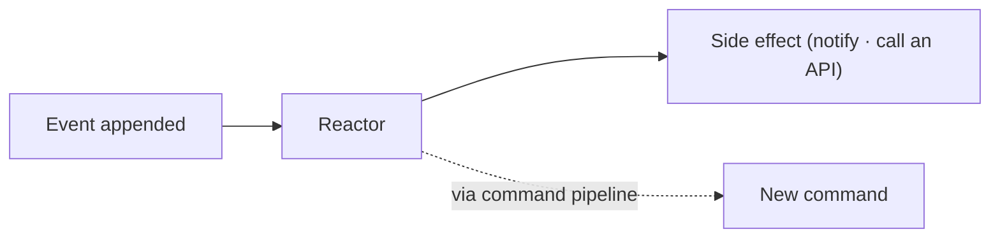

Cratis Chronicle reactors handle recorded events to trigger application work, such as sending a notification or calling an external API. Use a reactor when that work belongs after an event has been stored, rather than in the code that appends it.

A reactor reads an event sequence and keeps its own observation position: the point it has reached in that sequence. Chronicle uses this position to resume processing after a restart.

## Key Concepts

A handler is the application method that runs for an event type. Its event context supplies metadata such as the event source ID and sequence number. Each client has its own way to declare and register handlers; [Getting Started](getting-started) shows the differences.

Events from one event source, such as one order, are handled in sequence order within their partition. Different partitions can progress independently. If handling fails, inspect and retry the failed partition rather than restarting the reactor's entire history.

Replaying a reactor runs it against event history again. Decide which effects are safe to repeat before using that workflow. [Once-only processing](once-only) excludes work from replay, but does not prevent redelivery during recovery. Use [delivery identity](delivery-identity) when protecting an external effect from repeated delivery.

## When to Use Reactors

Reactors are a good fit when you need to:

- Trigger notifications or workflows when specific events occur
- Synchronize with external systems
- Start background processing after a business fact has been recorded
- Emit follow-up events based on patterns in the event stream

If you need a queryable view of event history instead, use a [projection](/chronicle/projections/) or [reducer](/chronicle/reducers/). Those build data to read; a reactor runs application code in response to a recorded fact.

## Basic Example

The example connects an event to a notification handler. Select your client to see its declaration and handler convention:

<ChronicleClientTabs snippet="reactors/index/basic-example" />

If you register artifacts explicitly in your .NET application's setup code, you can nominate a plain instance-method reactor without `IReactor`. Dispatch and dependency injection stay the same; see [explicit artifact registration](../clients/dotnet/explicit-artifacts).

## Topics

- [Getting Started](getting-started) — define and register your first reactor
- [Subscribe to External Event Stores](external-event-store-subscriptions)
- [Event Processing](event-processing) — choose a handler signature and supply its dependencies
- [Filtering](filtering) — restrict delivery by event metadata
- [Fluent Registration](fluent-registration) — register typed .NET delegates without a reactor class
- [Runtime Registration](runtime-registration) — handle event types known only by identifier in .NET
- [Returning Side Effects](side-effects)
- [Handling Events in Batches](batches)
- [Event Sequence](event-sequence)
- [Once-Only Processing](once-only)
- [Start at the Tail](start-at-tail)
- [Replay](replay)
- [Delivery Identity](delivery-identity)
- [Filtering by appended event metadata](../events/filtering/index.md)
- [Tagging Reactors](../concepts/tagging-reactors)

> Reactors react to **events**. To react instead to a **read model** being added, modified or removed — with the same convention-based methods, dependencies and side effects — see [Reacting to Read Model Changes](../read-models/reacting-to-changes).
