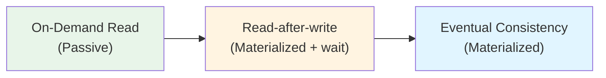
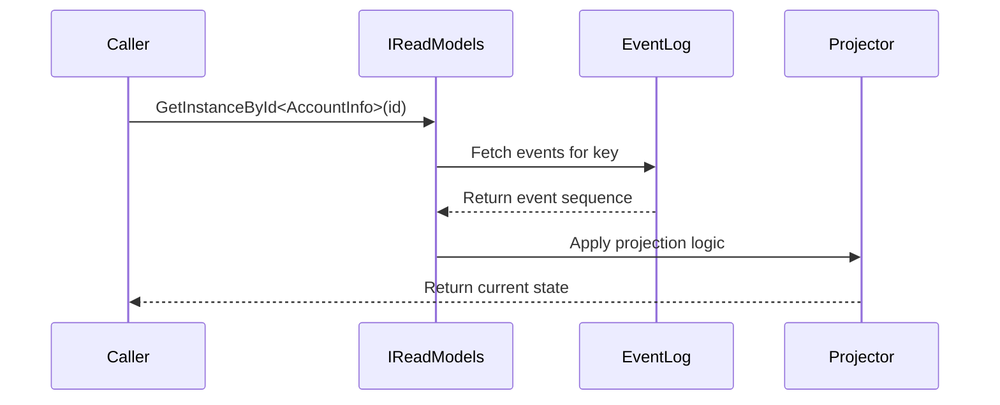
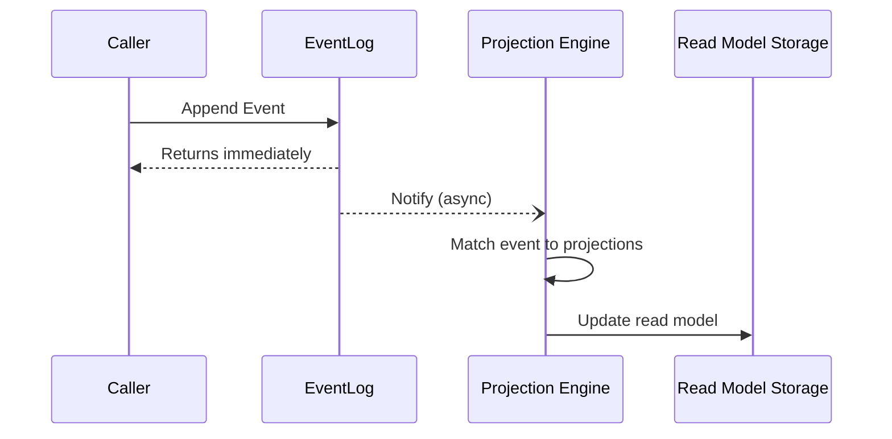

A book list can update after a borrowing command finishes. The command that borrows the last copy cannot rely on that list: another reader may be borrowing it too. Use a materialized view for browsing, a guarded read for the borrowing decision, and an explicit observer wait only when a caller needs to read back its own write.

> [!TIP]
> For information on how to define and configure read models in Arc, see [Chronicle read models in Arc](/arc/backend/csharp/chronicle/read-models/).

## The Consistency Spectrum

Start with a materialized projection for a frequently read screen. For a single instance with a suitable event history, a passive read model can compute the view on demand instead. Waiting for an append's observers lets one caller read its own write from a materialized model.

This diagram compares ways to obtain a view, not ways to protect a command. On-demand computation covers the requested model's supported event history; it is not a snapshot of every event in the system.

## On-Demand Computation

Use a passive read model when you want to display one instance by folding its source history at query time. Chronicle computes the result from events rather than waiting for a stored view to catch up.

You opt into this by marking the read model **passive**, which keeps any observer from materializing it and therefore leaves the event log as its only source. `GetInstanceById` then:

1. Locates the projection or reducer registered for the read model type
2. Retrieves all relevant events for the requested key from the event log
3. Executes the projection or reducer logic in memory, event by event
4. Returns the instance computed from that history

:::note
`IReadModels.GetInstanceById<T>(key)` computes on demand only for a passive read model. For a materialized projection or reducer, it reads the stored instance from the sink and releases protected values before returning it. See [getting a single instance](getting-single-instance.mdx).
:::

The sequence sketches a fold for one key. It does not establish a global freshness boundary or prevent another writer from appending after the read.

:::caution[A fresh read is not a guard]
An ordinary passive read does not carry a guard into the append that follows. Another writer can append between your read and your write, and both appends can succeed. To make a rule hold while writers race, use a [constraint](../constraints/index.md) or a [decision-consistent read](./decision-reads.mdx). See [Choosing how a rule holds](../dynamic-consistency-boundary/choosing.mdx).
:::

The replay reads only the events of the event source whose id is the key you asked for. That fits a read model keyed by its event source id. A projection that joins events from other event sources, or sets its key from event content with `UsingKey`, misses those events when read this way — keep it materialized, and wait for the append's observers when you need your own write back.

A [per-stream read model](per-stream.mdx) declares `[EventStream<TSource>(stream)]`, which implies passive. Its stream-aware instance read folds only the declared source type, stream type and requested stream ID; key-only reads are refused. A plain stream query still guards nothing. Use a stream-scoped decision read when a monthly rule must hold while writers race.

### When to Use On-Demand Computation

On-demand computation is the right choice when:

- You want to display a source-keyed instance without waiting for materialization
- The event history for each instance is short enough to fold on each request
- The read model is accessed infrequently relative to how often events are appended
- You are reading current state to show it, or to check something you can repair afterwards. A check that must hold when two writers race needs a [decision-consistent read](./decision-reads.mdx)

When those apply, [mark the projection passive](../projections/declarative/passive.mdx), then [read the instance by key](getting-single-instance.mdx). Use a materialized projection when you need a collection.

### Performance Considerations

Each on-demand read pays the cost of folding the relevant history. As that history grows, a materialized view can be a better fit for frequent reads.

## Read-after-write — waiting for a materialized read model

When a request must return a materialized view containing its own write, first check that its append succeeded. In the .NET client, call `appendResult.WaitForCompletion(explicitTimeout)`, then inspect `IsSuccess`, `TimedOut`, `FailedPartitions`, and `OutstandingObservers`. Read the model after successful completion. Follow [waiting for observer completion after append](../events/observing-appends.mdx#waiting-for-observer-completion-after-append) for the full procedure and server requirements.

The current server selects observers affected by the appended event types, including observers of all events; older-server behavior differs. Use an explicit timeout and handle incomplete processing. A timeout does not undo a successful append, so do not repeat the write just to make the view appear.

This wait adds processing latency to that caller. It neither protects the borrowing decision nor stops later writers from changing the model before the read.

There is no *immediate projection* mode that updates a read model during the append. [Immediate projections](../projections/immediate-projections.md) explains what the term does refer to.

## Eventual Consistency — Materialized Projections

Materialized projections keep stored views ready for queries. Appending an event and updating those views are separate work: append success does not require the relevant projection to have finished.

### How Materialization Works

The sequence is a sketch of the separate append and projection paths, not a required ordering of their completion. Processing may finish before the caller receives the append response or afterward. There is no fixed catch-up time.

For a detailed look at how projections are compiled and materialized from definition through to storage — covering the three projection styles and the runtime execution pipeline — see [Projection Architecture](../projections/architecture).

### Consistency Guarantees

A materialized query returns the stored view, which can lag behind the event log. Processing for one model does not prove that every other model has caught up, and different source keys need not become visible together.

Eventual consistency depends on observers being able to process their work. A paused observer or failed partition needs attention; waiting longer is not a fix for a broken mapping.

For patterns that help you design applications around eventual consistency, see [Eventual Consistency in Projections](../projections/eventual-consistency).

### When to Use Materialized Projections

Materialized projections are the right choice when:

- Read models are queried frequently and must respond quickly
- Event histories are long and on-demand computation would be too slow
- The application can tolerate a brief lag between an event being appended and the read model reflecting it
- High read throughput is needed independently of write throughput

## Choosing the Right Model

| Your task | Start with |
| --- | --- |
| Keep a book list current | A materialized projection and [Observe](observing-read-models.mdx) for replacement collections |
| Display one instance from a short, source-keyed history | A passive model and `GetInstanceById<T>(key)` |
| Return a view containing this request's append | Check append success, wait for its observers, then read |
| Borrow only when a copy remains, even with competing writers | A guarded command decision, as described below |

In an Arc application with [Chronicle integration](/arc/backend/csharp/chronicle/add-event-sourcing/), explicitly turn read protection **On** for the command or its assembly; the current unspecified default is **Off**. Take the keyed read model as a plain parameter in the command's `Handle()` method or `CommandValidator<T>` constructor. Check that a copy is available and let Arc stage and complete the command's returned events. Arc acquires the protected read and checks its guard when completing the write. Follow [your first protected command](/arc/backend/csharp/chronicle/consistency/getting-started/) and [command read rules](/arc/backend/csharp/chronicle/consistency/reads/) for supported model shapes and key lookup.

Outside Arc, obtain `eventStore.GetDecisionReads()`, call `GetDetached<T>(key)`, and decide from the returned state. Pass that same decision read in the event log's `AppendMany(..., guardedBy: ...)` call, then check append success and decision conflicts. [Decision reads](decision-reads.mdx) shows this guarded append and the alternative unit-of-work workflow, whose owner must complete the unit.

Both routes need a supported model shape, the correct source or stream key, and compatible client/kernel support. Keep the guard attached to the write. If the read cannot be protected, do not replace it with an ordinary query. A conflict rejects the stale decision; neither route locks the book or automatically reruns the command. For rules expressed directly over events, consider a [constraint](../constraints/index.md).

## Summary

| Read | What you get | Cost to consider |
| --- | --- | --- |
| Passive instance | A fold of the supported history for the requested key | Folding that history on each read |
| Materialized instance after a successful observer wait | A view whose processing includes this append | Observer processing time, then the stored read |
| Materialized query or observation | The stored view, updated asynchronously | Query or subscription work |

Use the live list to show available books, not to authorize borrowing the last copy. Protect that decision in the command, and add an observer wait separately if its response must include the resulting view.
