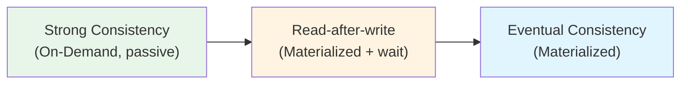
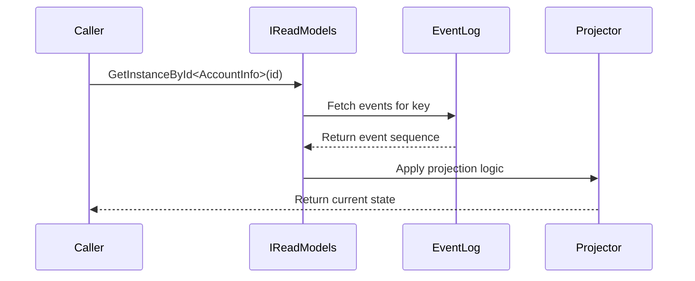
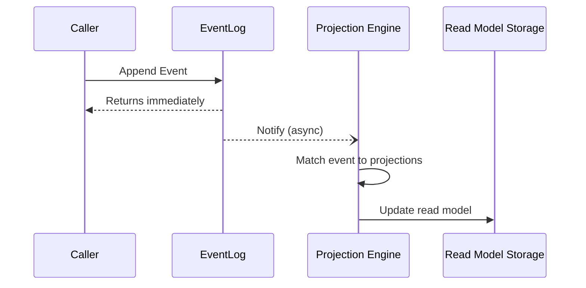

Read model consistency determines which events a result includes. In Cratis Chronicle, passive reads compute state from events on demand; materialized reads return stored state updated by an observer. Wait for observer completion when you need a stored read model to include your own append. If the result drives a decision that must hold under concurrent writes, protect the append with a decision read or a constraint.

> [!TIP]
> For information on how to define and configure read models in Arc, see [Chronicle read models in Arc](/arc/backend/csharp/chronicle/read-models/).

## The Consistency Spectrum

Choose based on what the caller needs to see: state computed from the event log, stored state that includes a particular append, or the latest state an observer has written. These choices concern read freshness. They do not, by themselves, prevent another writer from changing the state before your next append.

A dashboard can often use stored state while an observer catches up. A confirmation page may need to wait for its own write. A command enforcing a limit needs both a fresh read and a guard against competing writes.

## Strong Consistency — On-Demand Computation

An on-demand read rebuilds a read model from the event log instead of waiting for an observer to update stored state. Use it when the caller needs the source's event history reflected in the result and that history is short enough to process on each read.

You opt into this by marking the read model **passive**, which keeps any observer from materializing it and therefore leaves the event log as its only source. `GetInstanceById` then:

1. Locates the projection or reducer registered for the read model type
2. Retrieves all relevant events for the requested key from the event log
3. Executes the projection or reducer logic in memory, event by event
4. Returns the instance computed from those events

> [!IMPORTANT]
> An ordinary key lookup on a materialized read model reads the sink, the storage destination updated by its observer. It does not replay the event history. Chronicle releases compliance-protected values before returning the stored instance. See [Getting a Single Instance](getting-single-instance).

Because the read computes from events rather than the observer's stored result, it can include an event you have just successfully appended without waiting for materialization. It is still a read, not a reservation: events can arrive while you decide what to append next.

:::caution[A fresh read is not a guard]
A plain on-demand read does not carry a concurrency guard into the append that follows. Another writer can append between your read and your write without that plain read causing either append to be rejected. To make a rule hold while writers race, use a [constraint](../constraints/index.md) or a [decision-consistent read](./decision-reads.mdx). See [Choosing how a rule holds](../dynamic-consistency-boundary/choosing.mdx).
:::

The replay reads only the events of the event source whose id is the key you asked for. That fits a read model keyed by its event source id. A projection that joins events from other event sources, or sets its key from event content with `UsingKey`, misses those events when read this way — keep it materialized, and wait for the append's observers when you need your own write back.

A [per-stream read model](per-stream.mdx) declares `[EventStream<TSource>(stream)]`, which implies passive. Its stream-aware instance read folds only the declared source type, stream type and requested stream ID; key-only reads are refused. A plain stream query still guards nothing. Use a stream-scoped decision read when a monthly rule must hold while writers race.

### When to Use On-Demand Computation

On-demand computation is the right choice when:

- Strong read-after-write consistency is required
- The event history for each instance is short enough to replay on each request
- The read model is accessed infrequently relative to how often events are appended
- You are reading current state to show it, or to check something you can repair afterwards. A check that must hold when two writers race needs a [decision-consistent read](./decision-reads.mdx)

When those apply, mark the read model passive — see [Passive projections](../projections/declarative/passive). For a practical guide to working with read model instances, see [Getting a Single Instance](getting-single-instance) and [Getting a Collection of Instances](getting-collection-instances).

### Performance Considerations

Each on-demand read processes the relevant event history again, so its cost grows with that history. Measure against your request's latency requirements rather than choosing a fixed event-count threshold. For frequently accessed data with long histories, use materialization to avoid repeating that work.

## Read-after-write — waiting for a materialized read model

When one caller needs to read back its own append from a materialized model, wait for observer completion before reading. In the .NET client, first check that the append succeeded, then call `WaitForCompletion()` on its result. Check the wait result's `IsSuccess` too: it can report failed partitions or a timeout rather than successful completion.

With a server that supports event-type-scoped waiting, the .NET call waits for observers handling the appended event types and observers subscribed to all events. See [Waiting for observer completion after append](../events/observing-appends.mdx#waiting-for-observer-completion-after-append) for the call and failure handling.

Waiting adds the projection's latency to that one caller, and only that caller. Use it for the occasional read-after-write, not as a default on every append. When nearly every read needs to include the latest event, a passive read model is usually the simpler choice.

There is no *immediate projection* mode that updates a read model during the append. [Immediate projections](../projections/immediate-projections.md) explains what the term does refer to.

## Eventual Consistency — Materialized Projections

Materialized projections update stored read models asynchronously. An append persists events without waiting for that work to finish, so a successful append does not mean a subsequent stored read already includes it.

### How Materialization Works

An observer may already have processed an event by the time the caller reads, but append completion alone does not establish that. Processing lag depends on the workload and observer progress, including failures or recovery. Wait for completion when the caller must know that its append has been handled.

For a detailed look at how projections are compiled and materialized from definition through to storage — covering the three projection styles and the runtime execution pipeline — see [Projection Architecture](../projections/architecture).

### Consistency Guarantees

Projection processing preserves event order within an event source partition. Different partitions can progress independently, so their stored results need not represent the same point in the event log.

Failures can leave a partition behind. Do not treat elapsed time or a successful append as proof that its read model has caught up; check observer completion when the next action depends on it. Materialization does not make projection updates part of the append transaction.

For patterns that help you design applications around eventual consistency, see [Eventual Consistency in Projections](../projections/eventual-consistency).

### When to Use Materialized Projections

Materialized projections are the right choice when:

- Read models are queried frequently and must respond quickly
- Event histories are long and on-demand computation would be too slow
- The application can tolerate a brief lag between an event being appended and the read model reflecting it
- High read throughput is needed independently of write throughput

## Reading state to decide who may do something

An authorization check, such as "does this asset's plan include the feature", reads a small piece of recorded state per key and must fail closed. The consistency models above give these answers:

- **Freshness at admission.** A materialized read returns whatever its observer has written, so a plan granted or withdrawn a moment ago may not be visible yet. For a key that is the read model's event source id, mark the model `[Passive]`: `GetInstanceById` then computes it from that source's events, so it reflects an append you have just made without waiting for materialization. The cost grows with that source's event history, so keep such a model short; [Cheaper strongly consistent per-key reads](https://github.com/Cratis/Chronicle/issues/4745) tracks a cheaper path. A read, fresh or not, is not a guard against a writer changing the state afterwards; admission that must hold under concurrent writers belongs to a [decision read](./decision-reads.mdx), and its broader shapes are tracked in [Decision reads: admit broader projection shapes](https://github.com/Cratis/Chronicle/issues/5055).
- **Change signal for revocation.** To re-evaluate live subscriptions when the state changes, [watch the read model](./watching-read-models.mdx) or use a [read model reactor](./reacting-to-changes.mdx). A changeset carries the changed key, the resulting state and a removal flag, so the receiver can tell a withdrawn entitlement from an updated one. This rides the watch stream and is not transactional delivery: keep the last state per key, and treat a re-evaluation that cannot complete as a denial.
- **Failure behaviour.** A materialized read cannot tell "no such entitlement" from "the observer has not written it yet", because both return no instance. During a [replay](../concepts/observers.mdx#replay-and-definition-changes) the observer is inactive, and a quarantined observer does not catch up until someone clears it. Authorization that must fail closed therefore treats a missing instance as a denial, and uses a passive read when it needs to be certain the absence is real: with a passive model an absent instance means no events produced one. Do not read the stored instance of a model whose observer is replaying, rebuilding or quarantined as authoritative.

## Choosing the Right Model

| Scenario | Recommended Model |
|---|---|
| Showing state computed from the event log, such as a balance | On-demand computation |
| Read-after-write in the same request | On-demand computation, or waiting for the append's observers |
| A command check you can repair afterwards | On-demand computation |
| Rules that must hold when two writers race | A [constraint](../constraints/index.md), or a [decision-consistent read](./decision-reads.mdx) when the decision depends on an admitted read model |
| Dashboards and list views over large datasets | Materialized projections |
| Real-time UIs observing changes as they happen | Materialized projections with watchers |
| Infrequently accessed instances with short event histories | On-demand computation |

## Summary

| Model | Updated | Consistency | Read Cost |
|---|---|---|---|
| On-demand computation (passive) | At query time | Computed from events, without waiting for materialization | Proportional to event history length |
| Materialized, read after waiting | Asynchronously; the caller waits | Includes the caller's own append after successful observer completion | Stored lookup, plus the wait |
| Materialized projections | Asynchronously | Eventual | Stored lookup; no history replay |

Choose the read path for freshness, then choose how the rule is enforced. A plain passive read or an observer wait does not check at append time whether the state you used has changed. For a command that must reject a competing decision, continue with [decision-consistent reads](./decision-reads.mdx) or [constraints](../constraints/index.md). For a display that needs one instance, continue with [Getting a Single Instance](getting-single-instance).
