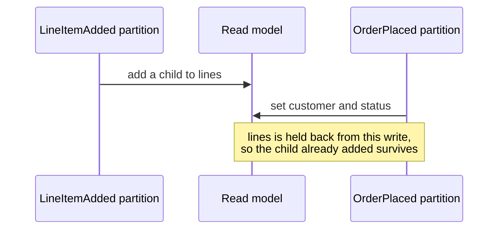

During root initialization, Chronicle omits child collection fields rather than writing `[]`. A previously populated collection can remain stored as `[]` after its last child is removed. When the .NET client reads a model with a missing field, a supported non-nullable collection becomes empty; a nullable collection preserves the distinction between missing (`null`) and stored empty (`[]`). Choose the declaration that matches what your application needs to know.

This applies to collections declared with `[ChildrenFrom<T>]` or a declarative `.Children(...)` projection. A newly created order, for example, can have no line items yet even though the order itself is ready to read.

## Root initialization leaves child collections untouched

Chronicle never writes a children collection on behalf of the root event. A children path is owned exclusively by the child add and remove operations for the whole lifetime of the read model, and the root projection's initial state is applied with every children path removed.

The root write must preserve children already stored, including during partition reprocessing. If a `LineItemAdded` has already added a child, allowing `OrderPlaced` to write `Lines = []` would erase it. Projection replay and catch-up each use a single step that reads events in sequence order; only reactors and reducers run that work independently per partition.

Omitting the field lets the root write leave children untouched. This exclusion applies only to children collections; Chronicle applies the rest of the initial state as written.

## What you read back

When the .NET client materializes a read model, it fills a missing collection property according to its declaration:

| Declared as | No value stored | A value stored |
| --- | --- | --- |
| `IEnumerable<LineItem> Lines` | An empty collection | Exactly that value, including `[]` |
| `IEnumerable<LineItem>? Lines` | `null` | Exactly that value, including `[]` |

With a supported non-nullable declaration, you can enumerate `Lines` without a null guard even before the first child arrives. A nullable declaration preserves the difference between an absent field and a stored empty list.

Strings and dictionaries are not normalized. Neither are collection types the reader cannot construct, such as an unsupported custom collection. Use a supported collection type when you rely on this behavior.

## Say which answer you want

Declare `Lines` as non-nullable if missing should mean empty, or nullable if absence matters to your application. No additional option or registration is needed:

<ChronicleClientTabs snippet="read-models/empty-child-collections/declaring" />

The rule is applied when the instance is materialized, not when it is stored, so changing a declaration takes effect for instances that were written long before you changed it. Nothing needs replaying.

A record-body normalizer such as `IEnumerable<LineItem> Lines { get; init; } = Lines ?? [];` does not cover every read path. Direct MongoDB reads can bypass the constructor, as explained under [Where these semantics apply](#where-these-semantics-apply) below and in [Designing read models](../concepts/designing-read-models#the-constructor-may-not-run).

## Initial values do not reach a child collection

Setting `Lines = []` through [initial values](../projections/declarative/initial-values) does not change this storage behavior. Chronicle removes every children path before applying the root's initial state, so that value never reaches the sink.

Use the declaration instead. Initial values remain the right tool for business defaults, sentinel values, and properties that are not children collections.

## Where these semantics apply

These rules belong to Chronicle's reader, not to the stored document. They apply wherever Chronicle materializes the read model for you — [reading a single instance](getting-single-instance), [reading a collection](getting-collection-instances), [materialized instances and paging](materialized-pagination), [snapshots](getting-snapshots), [watching a read model](watching-read-models), and [read model reactors](reacting-to-changes) — and to anything layered on those APIs. The [read model testing scenarios](/chronicle/testing/read-models/scenario/) materialize through the same code, so a spec and a running system answer this question identically.

A direct MongoDB query with `IMongoCollection<T>` uses the MongoDB driver's deserializer instead of Chronicle's reader. [Get started](/chronicle/get-started/) uses this path for reporting and ad-hoc reads. Without a matching convention, a missing collection field can become `null` even when you declared it non-nullable.

[Cratis Arc's MongoDB convention pack](/arc/backend/csharp/mongodb/convention-packs/) fills a supported non-nullable collection on a `[ReadModel]` type with an empty collection for both an absent field and a stored `null`. Without Arc, configure equivalent driver behavior or read through Chronicle.

:::caution
Do not rely on a record constructor to normalize direct MongoDB reads. Without a creator map, the driver creates the instance uninitialized and assigns members directly. Record-body defaults and guards, including `Lines = Lines ?? []`, then do not run, even for a complete document. See [The constructor may not run](../concepts/designing-read-models#the-constructor-may-not-run) before relying on constructor logic.
:::

:::note[Client coverage]
The absent-collection rule is applied by the .NET client's read model reader. Other clients materialize read models with their own runtime's deserialization — check what yours does with a missing field before relying on a non-nullable declaration.
:::

## Related topics

- [Children Collections](../projections/model-bound/children) - Declaring child collections on a read model
- [Consistency Models](./consistency.md) - When a read model has to be correct
- [Sinks](../sinks/) - Where read model instances are stored
