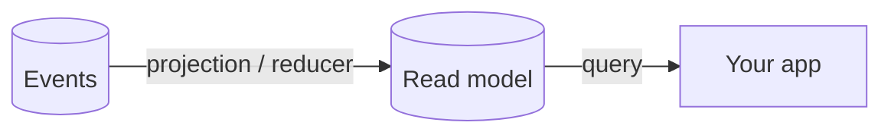

A read model in Cratis Chronicle is the view your application queries, built from events by a
projection or reducer. An account screen, for example, needs a name and balance rather than the
history of every deposit and withdrawal. Chronicle can store that derived state and keep it up to
date as events arrive.

This separates commands that record changes from queries that read the result, a pattern called
Command Query Responsibility Segregation (CQRS). The event log remains the source of truth; the
read model gives one reader the shape it needs.

One event log can feed several read models. An account summary and a transaction list need not
share a schema just because they use the same events. Separate models let each view change without
adding fields for unrelated readers, at the cost of maintaining another definition.

## How a read model gets built

Write changes as events rather than updating the read model directly. An
[observer](../concepts/observers/) processes those events: a [projection](../projections/) declares
how values map into the model, while a [reducer](../reducers/) applies state-transition code.

Start with model-bound attributes for straightforward mappings, move to fluent mappings when the
definition needs structure, and choose reducer code when transitions are clearer. A self-reducing
model is the default for new reducers. [Choose how to build a read model](../projections/choosing-a-read-model-style.mdx)
compares the same view across these forms and explains the cost of switching later.

## Read an instance

In the [.NET retrieval example](./getting-single-instance),
`eventStore.ReadModels.GetInstanceById<AccountInfo>(accountId)` returns an `AccountInfo` instance or
null. The caller checks for null before displaying its `Name` and `Balance`. The account id selects
the instance; you do not replay the events in your application to answer that query.

For a materialized model, this reads the stored result, which can lag behind a successful append.
A passive model computes its state on demand instead. Choose between those behaviors in
[Consistency models](./consistency.md); a fresh read alone does not guard a later write against
another caller's changes.

## When an instance becomes visible

A projection may receive child or joined data before the event that creates its root instance.
Chronicle retains that data in an internal placeholder, but excludes roots explicitly marked
`__initialized: false` from public keyed reads, collection pages and their total counts,
all-instance reads, previews, and live observations. The earlier data is still available when
the creating event arrives.

Projections with only child clauses never hide their roots. Initialized roots and older stored
roots without the marker also remain visible.

## What to read next

| Topic | What it covers |
| ------- | ----------- |
| [Choose how to build a read model](../projections/choosing-a-read-model-style.mdx) | Pick a builder based on the view you need. |
| [Consistency models](./consistency.md) | The key decision: when does the read model have to be correct — immediately, or eventually? |
| [Decision-consistent reads](./decision-reads) | Guard a command against a projection changing after it was read. |
| [Choosing how a rule holds](../dynamic-consistency-boundary/choosing.mdx) | Which mechanism makes a write-side rule hold, and why a plain read of a read model does not. |
| [Empty child collections](./empty-child-collections) | Why a child collection with no children is absent rather than `[]`, and how to say what that means. |
| [Read models scoped to one event stream](./per-stream.mdx) | Read one stream without mixing in other streams, and choose whether to guard a decision. |
| [Getting a single instance](./getting-single-instance) | Retrieve one read model instance by its key. |
| [Getting a collection](./getting-collection-instances) | Retrieve all instances of a read model. |
| [Getting snapshots](./getting-snapshots) | Retrieve historical snapshots of a read model's state. |
| [Watching read models](./watching-read-models) | Observe a read model and react to changes in real time. |
| [Releasing PII](./releasing-pii) | Decrypt personally identifiable information (PII) in a read model instance you already have, and how the subject is resolved. |
| [Indexing read models](./indexing) | Declare indexes with `[Index]` so they are recreated whenever the container is — including after a replay. |

To expose the result to a React frontend, pair it with an [Arc query](/arc/backend/csharp/queries/).
[Build a full-stack feature](/build-a-full-app/) follows the events-to-screen workflow.
