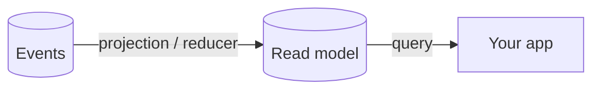

A Chronicle read model is a shaped, queryable view of your data that is built from events by projections or reducers.

Your events are the truth of *what happened*, but they're a terrible thing to query — to show an
account balance you'd have to replay every deposit and withdrawal. A **read model** is the answer to
that: a shaped, queryable view of your data, built from events and kept up to date for you. It's the
"read side" of CQRS — the events are the write side.

The power is specialization: one event log can feed *many* read models, each tailored to a single
screen or question. You don't reuse one model across conflicting needs — you build a focused one per
view, so each stays small, fast, and independent.

## How a read model gets built

You don't write to a read model directly — an [observer](../concepts/observers/) keeps it in sync with
the events:

- A [projection](../projections/) maps events into the model declaratively — the usual choice.
- A [reducer](../reducers/) folds events into the model as state-transition code.

Start with model-bound attributes, move to fluent mappings when the definition needs structure, and
choose reducer code when transitions are clearer; a self-reducing model is the default for new
reducers. **[Choose how to build a read model](../projections/choosing-a-read-model-style.mdx)** gives you
one decision path with scenarios, the same view four ways, and the cost of switching later.

## When an instance becomes visible

A projection can retain an internal root placeholder while children or joined data arrive before
its creating event. Public keyed reads, collection pages (including their total count), all-instance
reads, previews, and live observations exclude roots explicitly marked `__initialized: false`.
Roots of projections with only child clauses are never hidden.
The placeholder stays available to the projection, so its earlier data is retained when the root
is created. Initialized roots and older stored roots without the marker remain visible.

## What to read next

| Topic | What it covers |
| ------- | ----------- |
| [Choose how to build a read model](../projections/choosing-a-read-model-style.mdx) | Pick a builder based on the view you need. |
| [Consistency models](./consistency.md) | The key decision: when does the read model have to be correct — immediately, or eventually? |
| [Decision-consistent reads](./decision-reads) | Guard a command against a projection changing after it was read. |
| [Choosing how a rule holds](../dynamic-consistency-boundary/choosing.mdx) | Which mechanism makes a write-side rule hold, and why a plain read of a read model does not. |
| [Empty child collections](./empty-child-collections) | Why a child collection with no children is absent rather than `[]`, and how to say what that means. |
| [Read models scoped to one event stream](./per-stream.mdx) | Fold one account's month without mixing other months; guard a decision or make a plain query. |
| [Getting a single instance](./getting-single-instance) | Retrieve one read model instance by its key. |
| [Getting a collection](./getting-collection-instances) | Retrieve all instances of a read model. |
| [Getting snapshots](./getting-snapshots) | Retrieve historical snapshots of a read model's state. |
| [Watching read models](./watching-read-models) | Observe a read model and react to changes in real time. |
| [Releasing PII](./releasing-pii) | Decrypt PII in a read model instance you already have, and how the subject is resolved. |
| [Indexing read models](./indexing) | Declare indexes with `[Index]` so they are recreated whenever the container is — including after a replay. |

To expose a read model to a React frontend, pair it with an [Arc query](/arc/backend/csharp/queries/) — or see
the whole loop in [Build a full-stack feature](/build-a-full-app/).
