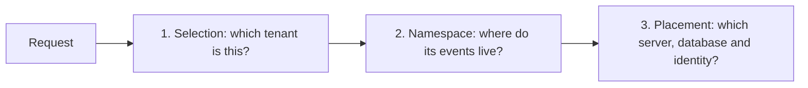

# Tenancy

Serving several customers from one Chronicle installation takes three separate decisions. Chronicle and [Cratis Arc](/arc/backend/csharp/tenancy/) each own some of them, and keeping them apart is what keeps tenants isolated.



| Decision | Who decides | Default |
| --- | --- | --- |
| **Selection**: which tenant a request belongs to, and whether the caller may use it | Your application. With Arc, a [tenant resolver](/arc/backend/csharp/tenancy/resolvers/) plus your authorization | No tenant, so the `Default` namespace |
| **Namespace**: the logical partition of events, observers and read models | Chronicle, from the tenant. With Arc the tenant id is the namespace name | `Default` |
| **Placement**: the physical database, server, schema and credentials | Chronicle derives names. With [storage connection resolution](../hosting/configuration/storage-connection-resolution.md) your platform decides | One server, one credential, names derived from the event store and namespace |

Chronicle isolates by the namespace it is given. It does not check that a caller may use a tenant, so authorize before you select.

## How it works by default

You configure nothing beyond the connection to your database server. Every namespace gets its own database, and Chronicle creates what is missing the first time a namespace is used.

For an event store named `Orders` and a tenant `acme`:

| Holds | `Default` namespace | Namespace `acme` |
| --- | --- | --- |
| Event sequences, observer state | `Orders+es+Default` | `Orders+es+acme` |
| Read models | `Orders` | `Orders+acme` |

The names are the same on MongoDB, PostgreSQL and SQL Server, with the cluster database name as the first part on SQL (`<cluster>+es+Orders+acme`). Two details are worth knowing:

- **Default-namespace read models live in the bare event store name.** Event sequences suffix every namespace, including `Default`. Composing `<eventStore>+<namespace>` for read models yields `Orders+Default`, which does not exist, and reads come back empty instead of failing. See [namespaces](../concepts/namespaces.md#database-naming).
- **Namespaces are created on first use.** A client that still has a namespace open brings it back the moment it appends.

With Arc, one fragment in the application is enough to map the tenant to the namespace. The tenant resolver decides where the tenant comes from; the Chronicle integration registers the namespace mapping. See [Arc's Chronicle tenancy](/arc/backend/csharp/chronicle/tenancy/). Without Arc, resolve the namespace yourself as described in [ASP.NET Core namespace resolution](../namespaces/aspnetcore.mdx).

## MongoDB and SQL: what differs

The model is the same. The details underneath are not.

| | MongoDB | PostgreSQL and SQL Server |
| --- | --- | --- |
| Isolation unit | A database per event store, namespace and read model set | The same, plus an optional schema inside each database |
| Database name limits | 63 bytes; rejects `/ \ . " $ * < > : \| ?` and the space. A bad namespace throws `InvalidDatabaseName` | 63 bytes (PostgreSQL) or 128 UTF-16 code units (SQL Server). Longer names become a readable prefix, `~` and a hash |
| Where the name is remembered | Derived each time | Recorded permanently in the cluster's `DatabaseNames` table, so a namespace never moves |
| Shared server | `storage.databaseNamePrefix` keeps several installations apart | The cluster database name is the prefix |
| Schemas | Not applicable | `storage.schema` keeps Chronicle's tables in a schema you choose |
| Resolved access token | `MONGODB-OIDC` credential | An Entra ID token on SQL Server, the password on PostgreSQL |
| Resolved password | Kept by the database client until the kernel restarts, so prefer tokens | Applied every time a connection opens, so rotation needs no restart |

See [storage](../hosting/configuration/storage.mdx) for the full naming and binding rules.

## Let your platform decide placement

Defaults suit a single team that owns its database server. A platform that places each tenant's database itself needs Chronicle to ask instead of derive. [Storage connection resolution](../hosting/configuration/storage-connection-resolution.md) does that for every event store, namespace and read model database, on MongoDB and SQL alike. Nothing changes until you configure `storage.connectionResolution`.

Chronicle describes what it connects for, and a resolver answers with only the parts it decides:

| Chronicle asks | A resolver answers (every part optional) |
| --- | --- |
| `storage`, `purpose` (`Runtime` or `Schema`) | `connectionString`, `database`, `schema` |
| `scope.kind`: `cluster`, `eventStore`, `namespace` or `readModels` | `identity`: `userName` and `password`, or `accessToken` |
| `scope.eventStore` and `scope.namespace` | `expiresAt` |

The resolvers (`Default`, `Template`, `Http` and `Custom`) and the REST contract are Arc's, so they behave the same for an Arc application and for the kernel: [connection resolution in Arc](/arc/backend/csharp/tenancy/connection-resolution/) and the [connection resolution contract](/arc/connection-resolution-contract/).

### Place tenants by a naming rule

A rule is enough when every tenant follows the same pattern. This puts each namespace's events and read models in separate databases on PostgreSQL:

```json
{
  "storage": {
    "type": "PostgreSql",
    "connectionDetails": "Host=pg.example;Database=chronicle;Username=chronicle;Password=secret",
    "connectionResolution": {
      "connection": {
        "resolver": "Template",
        "template": { "database": "{eventStore}_{namespace}_{kind}" }
      }
    }
  }
}
```

A resolved `database` is used as given. Chronicle does not derive a name for it and does not record a `DatabaseNames` binding. The cluster database is always `connectionDetails`.

### Fetch only the identity

When placement should stay Chronicle's but credentials come from your platform, resolve just the identity. The `connection` slot is left alone:

```json
{
  "storage": {
    "type": "MongoDB",
    "connectionDetails": "mongodb://cluster.example:27017",
    "connectionResolution": {
      "identity": {
        "resolver": "Http",
        "http": {
          "endpoint": "https://platform.example/internal/connections",
          "headers": { "X-Api-Key": "from-your-secret-store" }
        }
      }
    }
  }
}
```

### A database per tenant, with managed identities

For a platform that provisions tenant databases, with Entra managed identities and no database created by Chronicle, see [a database per tenant on Azure SQL](../hosting/configuration/storage-connection-resolution.md#a-database-per-tenant-on-azure-sql). It combines `createIfMissing: false`, `schema` and an `Http` resolver that answers `Runtime` and `Schema` with different identities.

## Keep Chronicle and your application aligned

Chronicle writes read models into its read model database. Your application, often through Arc, reads them from its own connection. They must end up in the same place, or reads come back empty:

| Default | With resolution |
| --- | --- |
| Arc's MongoDB naming is `<database>+<tenant>`, with the bare name for the default tenant. That matches Chronicle's read model naming when the Arc database name is the event store name | Both sides must resolve the same database. Serve one endpoint that answers Chronicle's `readModels` scope and Arc's tenant scope from the same placement record |
| Arc's EF Core uses one connection string for every tenant | Configure Arc's EF Core resolution to point at the database Chronicle's SQL sink writes to |

Chronicle's kernel and your Arc application are configured separately. Setting `Cratis:Arc:ConnectionResolution` does not change where the kernel stores anything, and `storage.connectionResolution` does not change what Arc connects to. The same resolver service can back both.

See [Arc: tenancy end to end](/arc/backend/csharp/tenancy/end-to-end/) for the application side.

## Retiring a tenant

Removing a tenant removes its namespace. Chronicle drops the events and observer state it owns, and stops the observers. It does not drop read model data, because your application owns it. With a resolved connection that data may be on a server Chronicle has never seen, so your platform is also the one to deprovision it. See [removing a namespace](../namespaces/index.md#removing-a-namespace).

## Checklist

- Authorize the caller for the tenant before selecting it. Namespaces isolate; they do not authenticate.
- Decide how the tenant id becomes a valid database name. Display-style ids such as `Hive Consulting` are rejected by MongoDB.
- Decide placement before storing data. Changing a resolution moves Chronicle to the new location and does not move existing data.
- Test an unset tenant, the default tenant and two named tenants, including concurrent requests.
- Verify the actual database each tenant's events and read models reach, not only the namespace name.

## Topics

- [Namespaces](../namespaces/index.md): what a namespace is and how clients select one
- [Storage](../hosting/configuration/storage.mdx): database naming, prefixes and permanent bindings
- [Storage connection resolution](../hosting/configuration/storage-connection-resolution.md): server, database, schema and identity per tenant
- [ASP.NET Core namespace resolution](../namespaces/aspnetcore.mdx) and [DotNET client usage](../namespaces/dotnet-client.mdx)
- [Arc tenancy](/arc/backend/csharp/tenancy/) and [Arc tenancy end to end](/arc/backend/csharp/tenancy/end-to-end/)
