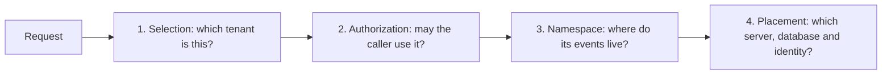

<a id="tenancy"></a>

Cratis Chronicle separates tenant data through namespaces: logical partitions within an event store. Use one namespace per tenant when several customers share a Chronicle installation. Your application must authorize access to each tenant; database placement determines where that tenant's events and read models are stored.



| Decision | Who decides | Default |
| --- | --- | --- |
| Selection: which tenant a request belongs to | Your application, or an Arc [tenant resolver](/arc/backend/csharp/tenancy/resolvers/) | Arc's unset or default tenant maps to the `Default` namespace |
| Authorization: whether the caller may use that tenant | Your application | Tenant selection does not check access |
| Namespace: the partition of events, observer state and read models | Your namespace resolver. With Arc's Chronicle integration, the tenant id becomes the namespace name | `Default` |
| Placement: the server, database, schema and credentials | Chronicle derives names, or your platform supplies them through [storage connection resolution](../hosting/configuration/storage-connection-resolution.md) | The configured server and credentials, with names derived from the event store and namespace |

Check the caller's access before any tenant data is read or written. A namespace name is not proof of authorization. If your application requires a named tenant, reject an unset or default tenant rather than allowing it to reach `Default`.

## How it works by default

With MongoDB, PostgreSQL or SQL Server, the default layout gives each namespace a database for its events and observer state, plus a separate read model database. These databases can share one server and credential; a database boundary does not give each tenant a separate database identity. By default, Chronicle creates missing databases as they are needed.

For MongoDB, an event store named `Orders` and a tenant `acme` use these names:

| Holds | `Default` namespace | Namespace `acme` |
| --- | --- | --- |
| Event sequences, observer state | `Orders+es+Default` | `Orders+es+acme` |
| Read models | `Orders` | `Orders+acme` |

PostgreSQL and SQL Server prefix these names with the configured cluster database name: `<cluster>+es+Orders+acme` for events and `<cluster>+Orders+acme` for read models. The default namespace's read models use `<cluster>+Orders`.

When your application reads a read model directly, use the read model database, not the event database. In particular, MongoDB's default namespace uses `Orders`, not `Orders+Default`. An incorrect connection can make existing data appear missing. See [namespace database naming](../concepts/namespaces.md#database-naming) before configuring those reads.

Namespace data is separate, but event types and observer definitions remain shared at the event store level. Namespaces are created on first use, so an active client can recreate a namespace after removal by appending to it.

With [Cratis Arc](/arc/backend/csharp/tenancy/), the tenant resolver supplies the tenant id and the Chronicle integration maps it to a namespace. Follow [Arc's Chronicle tenancy setup](/arc/backend/csharp/chronicle/tenancy/) to register that integration. Without Arc, configure your own resolver through [ASP.NET Core namespace resolution](../namespaces/aspnetcore.mdx).

## MongoDB and SQL: what differs

Choose the provider with naming limits and access requirements in mind. The namespace model stays the same, but database naming, credentials and schemas (named groups of tables) differ:

| | MongoDB | PostgreSQL and SQL Server |
| --- | --- | --- |
| Isolation unit | Separate databases for event-store metadata, namespace data and read models | The same, with a configurable schema for Chronicle's tables |
| Database name limits | 63 bytes; rejects `/ \ . " $ * < > : \| ?` and the space. A bad namespace throws `InvalidDatabaseName` | 63 bytes (PostgreSQL) or 128 UTF-16 code units (SQL Server). Longer names become a readable prefix, `~` and a hash |
| Default name binding | Derived from the event store and namespace | Recorded in the cluster's `DatabaseNames` table, keeping the derived physical name stable |
| Shared server | `storage.databaseNamePrefix` keeps several installations apart | The cluster database name is the prefix |
| Schemas | Not applicable | `storage.schema` selects Chronicle's schema. On SQL Server, the database user must have that schema as its default |
| Resolved access token | `MONGODB-OIDC` credential | An Entra ID token on SQL Server, the password on PostgreSQL |
| Resolved password | Kept by the database client until the kernel restarts; prefer access tokens for rotation. | Applied when a connection opens |

See [storage](../hosting/configuration/storage.mdx) for the full naming and binding rules.

## Let your platform decide placement

Keep the defaults when your team owns the database server and the derived names suit your application. Use [storage connection resolution](../hosting/configuration/storage-connection-resolution.md) when your platform provisions tenant databases or supplies their credentials. It lets Chronicle request a connection for an event store, namespace or read model database instead of deciding every part itself. Enable it through `storage.connectionResolution`.

A resolver receives the connection's purpose and scope, then returns the parts your platform controls. The scope identifies which logical database Chronicle needs. `Runtime` is for normal database work; `Schema` is for schema creation and migration:

| Chronicle asks | A resolver answers (every part optional) |
| --- | --- |
| `storage`, `purpose` (`Runtime` or `Schema`) | `connectionString`, `database`, `schema` |
| `scope.kind`: `cluster`, `eventStore`, `namespace` or `readModels` | `identity`: `userName` and `password`, or `accessToken` |
| `scope.eventStore` and `scope.namespace` | `expiresAt` |

Chronicle uses Arc's `Default`, `Template`, `Http` and `Custom` resolver implementations and REST contract. See [connection resolution in Arc](/arc/backend/csharp/tenancy/connection-resolution/) to choose a resolver, and the [connection resolution contract](/arc/connection-resolution-contract/) to implement an endpoint. Each storage integration applies the returned values according to its provider.

### Place tenants by a naming rule

A rule is enough when every tenant follows the same pattern. This puts each namespace's events and read models in separate databases on PostgreSQL:

```json
{
  "storage": {
    "type": "PostgreSql",
    "connectionDetails": "Host=pg.example;Database=chronicle;Username=chronicle;Password=secret",
    "connectionResolution": {
      "connection": {
        "resolver": "Template",
        "template": { "database": "{eventStore}_{namespace}_{kind}" }
      }
    }
  }
}
```

A resolved `database` is used as given. Chronicle does not derive a name for it or record a SQL `DatabaseNames` binding. The cluster database still comes from `connectionDetails`; resolution cannot move it. Changing placement does not migrate existing data, so plan that migration before changing a resolver.

### Fetch only the identity

When placement should stay Chronicle's but credentials come from your platform, resolve just the identity. The `connection` slot is left alone:

```json
{
  "storage": {
    "type": "MongoDB",
    "connectionDetails": "mongodb://cluster.example:27017",
    "connectionResolution": {
      "identity": {
        "resolver": "Http",
        "http": {
          "endpoint": "https://platform.example/internal/connections",
          "headers": { "X-Api-Key": "from-your-secret-store" }
        }
      }
    }
  }
}
```

### A database per tenant, with managed identities

For a platform that provisions tenant databases, with Entra managed identities and no database created by Chronicle, see [a database per tenant on Azure SQL](../hosting/configuration/storage-connection-resolution.md#a-database-per-tenant-on-azure-sql). It combines `createIfMissing: false`, `schema` and an `Http` resolver that answers `Runtime` and `Schema` with different identities.

## Keep Chronicle and your application aligned

Chronicle writes read models into its read model database. Your application reads them through a separate connection. Match the server and database on both sides, along with the schema where applicable, so the application queries the data Chronicle actually writes:

| Default | With resolution |
| --- | --- |
| Arc's MongoDB naming is `<database>+<tenant>`, with the bare name for the default tenant. That matches Chronicle's read model naming when the Arc database name is the event store name | Both sides must resolve the same database. Serve one endpoint that answers Chronicle's `readModels` scope and Arc's tenant scope from the same placement record |
| Arc's Entity Framework Core (EF Core) integration uses one connection string for every tenant | Configure Arc's EF Core resolution to point at the database Chronicle's SQL sink writes to |

Chronicle's kernel and your Arc application are configured separately. Setting `Cratis:Arc:ConnectionResolution` does not change where the kernel stores anything, and `storage.connectionResolution` does not change what Arc connects to. The same resolver service can back both.

See [Arc: tenancy end to end](/arc/backend/csharp/tenancy/end-to-end/) for the application side.

## Retiring a tenant

Stop the tenant's requests and background clients before removing its namespace; an append can otherwise create it again. Namespace removal first forgets the namespace so it is no longer listed, then stops and removes its observers. The default namespace cannot be removed.

MongoDB also drops the namespace database containing events and observer state. The SQL provider leaves stored namespace data in place. Neither drops the separate read model data, so include that data and any retained SQL databases in your deprovisioning plan. Follow [removing a namespace](../namespaces/index.md#removing-a-namespace) for the operation and its boundaries.

## Checklist

- Authorize the caller for the selected tenant before accessing data. Reject unset or default tenants if your application requires a named tenant.
- Decide how the tenant id becomes a valid database name. Display-style ids such as `Hive Consulting` are rejected by MongoDB.
- Decide placement before storing data. Changing a resolution moves Chronicle to the new location and does not move existing data.
- Test an unset tenant, the default tenant and two named tenants, including concurrent requests.
- Verify the actual database each tenant's events and read models reach, not only the namespace name.

## Topics

- [Namespaces](../namespaces/index.md): what a namespace is and how clients select one
- [Storage](../hosting/configuration/storage.mdx): database naming, prefixes and permanent bindings
- [Storage connection resolution](../hosting/configuration/storage-connection-resolution.md): server, database, schema and identity per tenant
- [ASP.NET Core namespace resolution](../namespaces/aspnetcore.mdx) and [DotNET client usage](../namespaces/dotnet-client.mdx)
- [Arc tenancy](/arc/backend/csharp/tenancy/) and [Arc tenancy end to end](/arc/backend/csharp/tenancy/end-to-end/)
