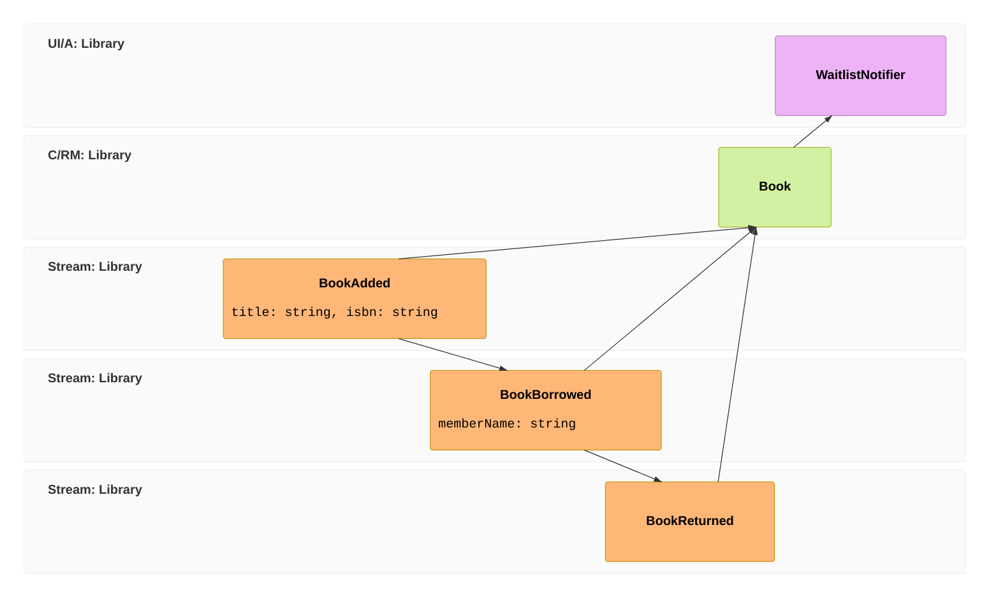

This Cratis Chronicle tutorial builds a small library system to teach event sourcing one task at a time. You will record a book arriving, derive a catalog you can query, and react when a borrowed book comes back. Each chapter adds one part to the same model, so you can see how storing a fact differs from updating a row.

The library needs both a history of changes and a current view: which books arrived, which are on loan, and who should hear when a title returns. We will record those changes as events, then use them to build the catalog and notify the next member waiting for a book.

The diagram shows the flow we will build. `BookAdded`, `BookBorrowed`, and `BookReturned` feed the `Book` read model. `WaitlistNotifier` represents the code that acts on a return. You can follow the tutorial without knowing the diagram notation; [the event-modeling guide](/event-modeling/) explains it if you want to use it for your own designs.

In C#, the events become records marked with `[EventType]`. The **read model** is a queryable `Book`, derived from the events by a projection. The **reactor** implements `IReactor` and runs application code when a matching event arrives. The chapters introduce those APIs as you need them.

This tutorial calls Chronicle directly rather than building screens and commands. For that application layer, [Arc](/arc/) builds on Chronicle; [the full-stack capstone](/build-a-full-app/) shows how the pieces connect.

## What you'll need

You need a [locally running kernel](/chronicle/get-started/#start-chronicle) and a project connected to a Chronicle client. For C#, [choose an application host model](/chronicle/get-started/choose-hosting-model/) and follow its console, worker, or ASP.NET Core quickstart. For another language, use the [client choices in Get started](/chronicle/get-started/#pick-a-client) to find the setup guide.

The narrative follows C#. The snippets also show Kotlin, Elixir, and TypeScript; Kotlin and Java use the same JVM client, with Kotlin syntax shown here. Select your language on a snippet and follow its registration instructions from setup. Client capabilities differ, and the chapters name missing operations where they affect an example.

## The tour

1. **[Your first event](./first-event)** — record the fact that a book arrived, and meet the event log.
2. **[Building a read model](./read-model)** — turn that stream of facts into something you can actually query.
3. **[Reacting to events](./reacting)** — do something useful when a book comes back.

Start with [your first event](./first-event). That chapter records a book but does not yet produce a queryable catalog. The read-model chapter adds the catalog; the reactor chapter then adds the notification. Each step explains what changed and what is still missing.

After the tour, use the [Scenarios](../scenarios/) recipes for focused Chronicle tasks.
