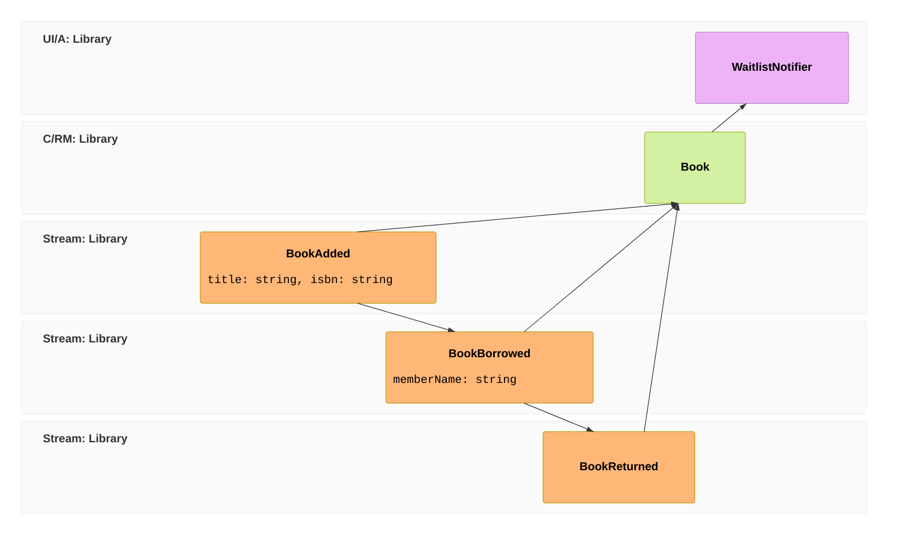

Imagine you're building the system for a small town library. Books arrive, members borrow them, and eventually bring them back — and when a popular title comes back, the next person on the waitlist should hear about it. It's a small domain, but it has everything event sourcing is good at: things *happen*, in order, over time, and you care about the history, not just the latest state.

Start by running a complete .NET console project: append a book, then observe its first read model with a bounded query. Later sections explain loan-state mappings and reactions. They extend the model, but aren't a fully verified end-to-end lending application.

Here's the whole system we're heading toward, drawn as an **[event model](/event-modeling/)** — read it left to right like a comic strip: facts happen over time, get folded into a read model you can query, and trigger a reaction. Don't worry if the pieces aren't familiar yet; we'll meet each one in turn.

Every block is a real Chronicle primitive — which is what makes an event model such a good plan. The three **events** become `[EventType]` records, the **read model** becomes a queryable `Book` projected from all three of them, and the **processor** becomes a **reactor** — an `IReactor` that acts when something happens. You'll build them in that order. There's no screen or command here because Chronicle appends events directly — put a UI and commands on top with [Arc](/arc/) and the model gains those blocks too, as [the full-stack capstone](/build-a-full-app/) shows.

## What you'll need

Use the .NET 10 SDK, Docker and the released `Cratis.Chronicle` 19.115.3 / `cratis/chronicle:19.115.3-development` pairing. [Get started](/chronicle/get-started/#start-chronicle) starts the kernel and checks health. Leave it running throughout the first two chapters.

[Your first event](./first-event) gives the project-creation commands and every file to place beside `LibraryTutorial.csproj`. You don't need the console quickstart first. If you already ran it, create this tutorial project separately: its `Book*` types and `LibraryTutorial` event store are distinct from `GetStarted*` and `Quickstart`. Client tabs show client-owned equivalents; this complete runnable path is for .NET.

Read models are eventually consistent. The read-model chapter waits for a specific id and expected fields rather than assuming an immediate query is current. Its runnable scope is the first projected book: later borrowed-state observations have intermittently timed out at 60 seconds with this pairing, so the loan and return mappings are explanatory extensions, not a promise of timely state transitions.

[Choose an application host model](/chronicle/get-started/choose-hosting-model/) covers alternative console, worker and ASP.NET Core wiring.

## The tour

1. **[Your first event](./first-event)** — record the fact that a book arrived, and meet the event log.
2. **[Building a read model](./read-model)** — turn that stream of facts into something you can actually query.
3. **[Reacting to events](./reacting)** — do something useful when a book comes back.

The tour introduces the loop at the heart of Chronicle — *append a fact, project it into state, react to it*. The first two chapters provide the runnable append-and-observe path; the final chapter explains reactions. After the tour, use the [Scenarios](../scenarios/) recipes when you need to solve a focused Chronicle task.

Ready? [Let's record the first thing that happens →](./first-event)
