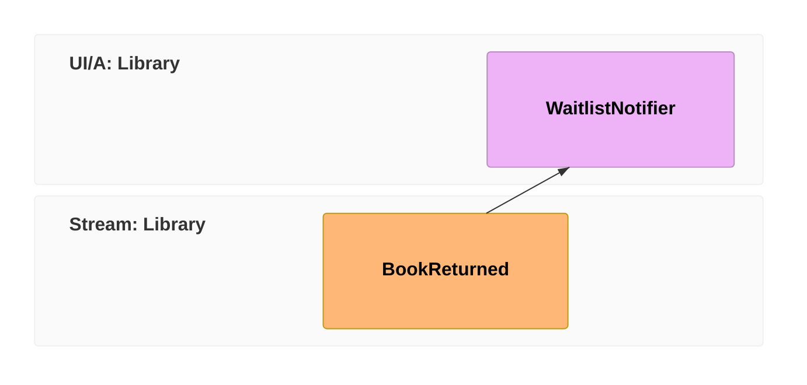

A reactor in Cratis Chronicle handles a recorded event to perform application work. Here you'll react to `BookReturned` by calling a notification service, so the next member waiting for the book can hear that it is available. The projection from the previous chapter maintains the loan view; the reactor performs the follow-up action.

Continue with your connected client, the book's saved event-source ID, and the events from the previous chapters. The examples show the handoff to a notification service, not an implementation of a waitlist or message delivery. Start with a service that logs the book ID so you can observe the call without sending messages.

In [event-modeling](/event-modeling/), this is the **automation pattern**: a processor watches for an event and acts. It completes this part of the library model:

## A reactor is just a class that watches for an event

In C#, implement the marker interface `IReactor` and give the handler `BookReturned` as its first parameter. Chronicle uses that type to route matching events to the method. The `EventContext` argument supplies the book's event-source ID, which the service needs to identify its waitlist.

Provide the `INotificationService` implementation through your application's dependency injection setup before starting the client. For the other languages, follow the service shape in the selected example:

<ChronicleClientTabs snippet="tutorial/reacting/waitlist-notifier" />

Keep the reactor in your client's configured discovery or registration scope. The C# client discovers `IReactor` implementations; the other tabs use their clients' reactor declarations. In the TypeScript example, retain the `bookReturned` method name because that example discovers the handler by name.

With the client connected and the reactor registered, append a `BookReturned` under the same book ID used in the previous chapters. Check your logging service: it should receive that ID. The append records the event first; the notification call happens later when the reactor processes it.

## Why your reactor must be safe to repeat

A reactor may handle the same event more than once, including during replay or recovery after a failure. A notification service that sends a message on every call can therefore send duplicates. Make the effect **idempotent**: repeating the call for the same delivery must not send another message.

Use a receipt keyed to the delivery or a notification API that accepts a stable deduplication key. Recording success only after sending leaves a failure window: the message can be sent before the receipt is saved. Decide how the service will handle that case before replacing the logging implementation with real delivery.

To exclude a C# reactor or handler from replay, mark it `[OnceOnly]`. This prevents replay caused by redactions, revisions, or observer rewinds from repeating its effect. It also means an intentional replay will not recreate that effect.

`[OnceOnly]` does not prevent ordinary retries. If the handler throws, processing pauses for that event source's partition, the group of events being processed for that source. Recovering the partition delivers the event again. For retry protection in .NET, use the [delivery identity](/chronicle/reactors/delivery-identity/) to key a receipt or pass a stable key to an API that deduplicates. The marker alone is not an exactly-once guarantee.

<ChronicleClientTabs snippet="tutorial/reacting/once-only" />

Kotlin and Java use `@OnceOnly`; TypeScript uses `@onceOnly()` on a class or handler. Elixir uses `once_only:` on `use Chronicle.Reactors.Reactor`, either for the whole reactor or selected event types. These controls exclude replay, not retries. Choose one notifier implementation as you follow the examples: registering several variants would make each react to the same return.

## Read the book's title

`BookReturned` has no title. To send a message such as "The Pragmatic Programmer is back", read the `Book` view using the event-source ID from the context.

The view from the previous chapter is materialized, so the lookup reads stored state with eventual consistency. The title does not change in this tutorial, but the instance can still be missing if `BookAdded` has not been projected yet. Handle that case before accessing the title; the C# example below assumes the instance exists:

<ChronicleClientTabs snippet="tutorial/reacting/reading-state" />

The clients obtain that state differently. C# looks it up through `IEventStore`. Kotlin and Java declare a read-model parameter, which Chronicle resolves using the triggering event's source ID. TypeScript receives `ReactorServices` and uses its `readModels`; its constructor-injected notification service requires an `artifactActivator` in `ChronicleOptions`. Elixir calls `Chronicle.read_model/2` and handles a missing instance or read error explicitly.

For state that must include the triggering event, review the [consistency levels](../concepts/consistency.md) and the passive read-model option. A C# model marked `[Passive]` is [computed from events on each read](../read-models/getting-single-instance), rather than fetched from the stored view. Neither a plain stored read nor a passive read guards a later append against competing writes.

## Record the notification outcome

If successful notification is a fact your application needs to retain, define an event for it:

<ChronicleClientTabs snippet="tutorial/reacting/notification-sent-event" />

One option is to append it inside the handler after the notification call succeeds. Check the append result and report failure instead of allowing the handler to appear successful without recording the fact. The C# example throws when the append fails, pausing the partition for recovery. Retrying runs the whole handler again, including the notification call:

<ChronicleClientTabs snippet="tutorial/reacting/explicit-append" />

Use the explicit-append example in C#, TypeScript, or Elixir. The Kotlin and Java tabs have no explicit-append example; follow their returned-event example below.

You can instead return the new event as a **side effect**, an output Chronicle handles after your method completes. Chronicle appends it to the event log under the triggering book's event-source ID:

<ChronicleClientTabs snippet="tutorial/reacting/side-effect" />

In C#, the returned event is appended with an idempotency key derived from the reactor delivery, so the retry described above does not append it a second time; the notification call itself still runs again, so keep it idempotent. See [Duplicate protection for returned events](/chronicle/reactors/side-effects/#duplicate-protection-for-returned-events).

The returned-event example is available for C#, Kotlin, Java, and TypeScript. Elixir returns `{:ok, event}` from `handle/2`. After adding the new event type to your client's discovery or registration, replace the basic notifier with this variant. Append another `BookReturned`, check the service call, and find `WaitlistNotificationSent` under the same book ID in the event log. This records completion of your service call, not proof that a member read the message.

## Use the event, not a lookup

Use `context.EventSourceId` to identify the returned book. Querying the current loan view to discover that identity would be unreliable: it may still show the loan or may already have removed it. The event context gives you the identity regardless of the view's progress.

Read a model for additional information, such as the title, with its freshness and missing-instance behavior in mind. Using the event's identity avoids an unnecessary lookup; it does not by itself make the notification idempotent.

## You've built a library

You have the backend pattern for the library: append facts, project them into loan views, and react to a return by calling a service. Projections and reactors consume the log independently; the notification does not wait for the catalog to catch up. A working waitlist, real message delivery, and duplicate protection in that service remain application work.

Before adding those pieces, [test a slice](/chronicle/scenarios/test-a-slice/) to check event appends and derived read-model state with `EventScenario` and `ReadModelScenario`. Then choose the next task:

- Use [Scenarios](/chronicle/scenarios/) for focused recipes such as enforcing uniqueness or evolving events.
- Add commands and a UI with [Arc](/arc/) and [Components](/components/) in [Build a full-stack feature](/build-a-full-app/).
- Review [Concepts](/chronicle/concepts/) and the guides for [Projections](/chronicle/projections/), [Reactors](/chronicle/reactors/), and [Reducers](/chronicle/reducers/) when your own model needs more than this example.
- Use [Troubleshooting](/chronicle/troubleshooting/) if an append, view, or reactor does not behave as expected.
