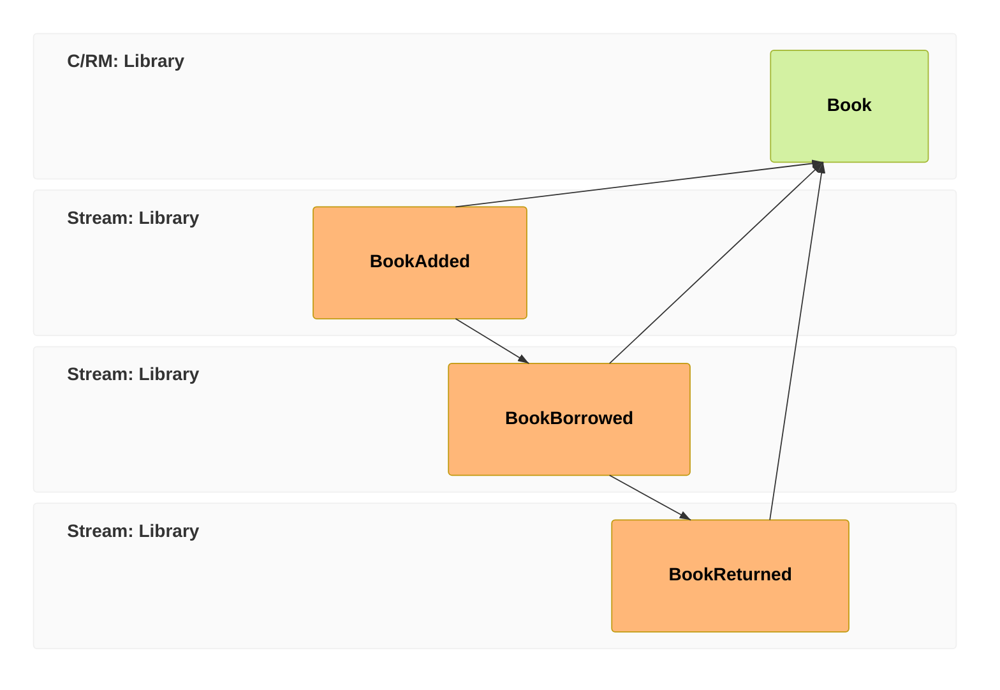

A read model in Cratis Chronicle turns recorded events into data your application can query. Here you'll build a library catalog that shows which books are on loan, then a second view containing only borrowed books. Chronicle applies your event mappings to maintain both views.

Continue with the connected client and book ID from the previous chapter. Keep that ID: `BookAdded`, `BookBorrowed`, and `BookReturned` must belong to the same book for these views to describe its history.

In [event-modeling](/event-modeling/), this is the **view pattern**: events feed a read model that a UI can query. This chapter builds that part of the library:

## First, a couple more facts

Add two event types alongside `BookAdded`: `BookBorrowed` records the member's name, and `BookReturned` records that the book came back. Include them in your client's event-type discovery or registration, as you did for `BookAdded`:

<ChronicleClientTabs snippet="tutorial/read-model/a-events" />

`BookReturned` has no payload fields. The event's context supplies the book's event-source ID and when it happened, so the event does not need to repeat that information.

## Declare what you want to read

Define a `Book` read model and map the three events onto its properties. The mapping is a [projection](/chronicle/concepts/projection/): instructions for deriving state from events, including how to rebuild it from history.

Follow the catalog example below in C#, TypeScript, or Elixir. The Kotlin and Java tabs have no catalog implementation; use their borrowed-book view later in this chapter.

<ChronicleClientTabs snippet="tutorial/read-model/book" />

In the C# example, `BookAdded` supplies `Title` and `Isbn` and sets `OnLoan` to `false`. `BookBorrowed` sets `OnLoan` to `true` and copies `MemberName` into `BorrowedBy`. `BookReturned` sets `OnLoan` back to `false`. Chronicle applies these mappings in event order, including when it rebuilds the view.

This mapping does not clear `BorrowedBy` on return. It retains the last borrower's name, so use `OnLoan` to decide whether that name describes a current loan.

:::note[FromEvent maps by convention]
In C#, the class-level `[FromEvent<BookAdded>]` maps matching property names: `BookAdded.Title` supplies `Book.Title`, and `BookAdded.Isbn` supplies `Book.Isbn`. `[SetFrom<T>]` makes a mapping explicit, as with `BookBorrowed.MemberName` supplying `BorrowedBy`. The TypeScript and Elixir examples spell out their field mappings.
:::

:::tip[Reach for the declarative path first]
This projection keeps the mapping beside the read model, using model-bound attributes in C#. `[SetValue<T>]` assigns constants such as `true` and `false` when an event arrives. If deriving a view needs application logic that these mappings cannot express, use a [reducer](/chronicle/reducers/) to compute the next state in code.
:::

## Query it

Chronicle **materializes** this projection: an observer processes events and stores the resulting state in a **sink**, the projection's storage destination. The C# default is MongoDB. With the default naming, `Book` instances live in the `Books` collection in the database named after your event store.

For the C# query below, use [the MongoDB setup in Get started](/chronicle/get-started/console/#configure-the-mongodb-client) to supply an `IMongoCollection<Book>` for that collection. `Books` is the query class; each document it reads is a `Book` instance. Its `OnLoan()` method returns only books whose `OnLoan` flag is `true`:

<ChronicleClientTabs snippet="tutorial/read-model/query" />

Restart or reconnect your client with the new event types and projection included in its discovery or registration. Then exercise the mapping using the append pattern from the first chapter:

1. Query the on-loan view after `BookAdded` has been projected. The book is not in this result because `OnLoan` is `false`.
2. Append `BookBorrowed` with a member's name under the saved book ID. Once the projection catches up, query again: the book appears with `OnLoan` set to `true` and `BorrowedBy` set to that name.
3. Append `BookReturned` under the same ID. After processing, the book disappears from the on-loan result. Its `Book` instance still exists in the catalog with `OnLoan` set to `false`.

:::note[An append completes before the view catches up]
The stored view is [eventually consistent](/chronicle/read-models/): a successful append does not mean the projection has processed it yet. If a query still shows the previous state, allow processing to catch up before checking again. Do not use this unguarded stored view alone to decide whether another borrow is allowed.
:::

## A view that removes itself

The catalog retains every book, while its query filters for current loans. You can also make membership in a view represent the loan itself: create a `BorrowedBook` when a book is borrowed and remove it when the book comes back. Then querying all instances answers "what's out on loan?" without a flag filter:

<ChronicleClientTabs snippet="tutorial/read-model/borrowed-book" />

This example includes Kotlin and Java implementations using `@FromEvent` and `@RemovedWith`. In C#, `[FromEvent<BookBorrowed>]` creates the instance, mapping `MemberName` by convention and using the book's event-source ID as its key. `[RemovedWith<BookReturned>]` removes that instance when a return event arrives for the same book.

Query all instances of this view:

<ChronicleClientTabs snippet="tutorial/read-model/borrowed-books-query" />

After registering this projection, append another borrow and return for the same book ID. Once each event is processed, the `BorrowedBooks` query first includes the book and then excludes it. Unlike the first view, the returned book no longer has an instance in this sink. Removing that instance does not delete its events from the log.

Both views use the same history. One retains the catalog entry and its loan flag; the other retains only current loans. Choose a view's shape around the question its caller needs to answer.

## What you did

You mapped borrow and return events onto queryable state. The catalog keeps the book after a return; the `BorrowedBook` view removes it. Both depend on processing recorded events, so their stored results can lag an append.

The application can now show loans. In the [final chapter](./reacting), you'll react to a return by calling a notification service for the next member waiting. [Continue to reactors →](./reacting)
