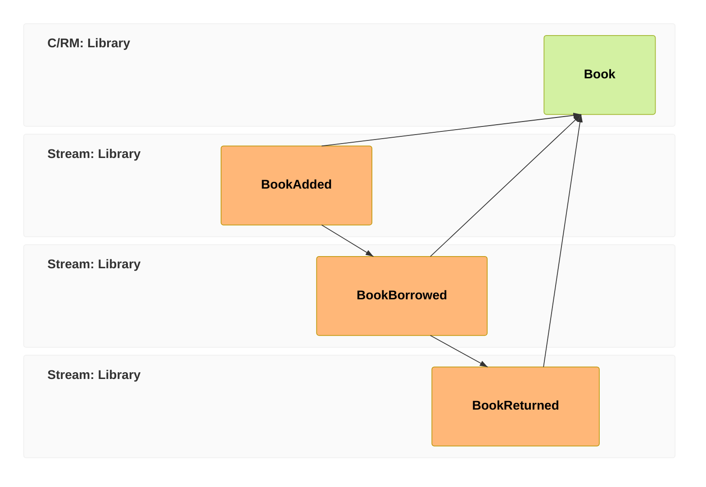

We can record that a book arrived, but the librarian can't *see* the catalog yet — the books live only as history in the log. In this chapter we'll fix that: we'll build a `Book` read model that derives each book's state from its events, and — here's the part that surprises people coming from CRUD — we'll do it **without writing a single line that updates anything**.

In [event-modeling](/event-modeling/) terms that's the **view pattern** — events fold into a read model the UI can query. It's the slice of the model we build in this chapter:



## Keep the first chapter's files

Continue in the `LibraryTutorial` project from [Your first event](./first-event), using .NET 10, `Cratis.Chronicle` 19.115.3 and the same running `19.115.3-development` kernel. Keep `BookAdded.cs`, `BookId.cs` and `TutorialFirstEventAppend.cs`. Replace `Program.cs` at the run step below; don't add a second entrypoint.

This chapter's runnable result is **one newly added book observed in the catalog**. Loan and return mappings below explain the model, but aren't a guaranteed borrow/return walkthrough for this release: local runs of this package/image pairing have intermittently timed out waiting 60 seconds for a borrowed state. A timeout alone doesn't establish the cause or mean the event was lost.

## First, a couple more facts

A book doesn't just arrive; it gets borrowed and brought back. Those are facts too, so they're events:

<ChronicleClientTabs snippet="tutorial/read-model/a-events" />

Save these declarations as **`LoanEvents.cs`** beside the project file.

Notice `BookReturned` has no data at all — and that's fine. The fact that it *happened*, on a particular book's stream, at a particular time, is the whole story. Not every event needs a payload.

## Declare what you want to read

Here's the shift. In a database you'd write code to keep a `Books` table in sync — insert on add, update a flag on borrow, update it back on return. In Chronicle you instead **declare the shape you want** and tell it which events feed it. Chronicle does the keeping-in-sync for you. That declaration is a [projection](/chronicle/concepts/projection/):

<ChronicleClientTabs snippet="tutorial/read-model/book" />

Save the model as **`Book.cs`** in the same project. The client discovers and registers its model-bound projection when it opens the event store; no extra registration helper is needed.

Read the attributes as a sentence: a book is *made from* `BookAdded` — its `Title` and `Isbn` come straight off the event; `OnLoan` is `false` when the book is added, `true` when it's borrowed, and `false` again when it's returned; `BorrowedBy` is set to whoever borrowed it. You're *declaring* how each fact maps onto the view — not writing imperative updates, not worrying about ordering. Chronicle replays the events in order and applies your mapping.

:::note[FromEvent maps by convention]
The class-level `[FromEvent<BookAdded>]` maps event properties to read model properties **by naming convention** — `BookAdded.Title` lands in `Book.Title` and `BookAdded.Isbn` in `Book.Isbn` because the names match, with nothing else to write. You only reach for a property-level `[SetFrom<T>]` when the names *don't* line up — like `BookBorrowed.MemberName` feeding `BorrowedBy` above.
:::

:::tip[Reach for the declarative path first]
For mappings like this — "events map onto fields" — the model-bound attributes (`[FromEvent<T>]` for by-convention mapping, `[SetFrom<T>]` and `[SetValue<T>]` for the exceptions) express it with almost no code. Only when a view genuinely needs hand-written, imperative folding should you drop to a [reducer](/chronicle/reducers/). Try the projection first; you'll rarely need more.
:::

Kotlin and Java's model-bound projections don't currently have an equivalent to `[SetValue<T>]` — setting a literal value per event type — so this particular projection isn't available in those two clients yet.

## Observe the first projected book

The kernel **materializes** this projection into its configured **sink** — MongoDB in the development image. The default collection name is the pluralized model name, `Books`. Query through Chronicle here, so you don't need a MongoDB driver or a database port exposed on the host.

Replace all of **`Program.cs`** with this entrypoint and bounded polling helper:

<ChronicleClientTabs snippet="tutorial/read-model/program" />

Your source files are now:

```text
LibraryTutorial/
  LibraryTutorial.csproj
  BookAdded.cs
  BookId.cs
  TutorialFirstEventAppend.cs
  LoanEvents.cs
  Book.cs
  Program.cs
```

Run from `LibraryTutorial`:

```shell
dotnet run --configuration Release
```

Expected output, with the same generated id on both lines:

```text
Appended BookAdded for <book-id>
Projected <book-id>: The Pragmatic Programmer | 978-0135957059 | OnLoan=False
```

This run appends a **new** book so its result can be identified even when the earlier chapter's book is already present. The kernel can also project that historical event; the check deliberately selects only the new id.

### Append success is not projection readiness

Read models are [eventually consistent](/chronicle/read-models/). `GetInstances<Book>()` reads **current materialized state** and does not wait for catch-up. The first query may be empty or stale even after append succeeds. The helper checks the id and expected fields every 250 ms and stops after a 60-second observation deadline; it never assumes a fixed sleep made the view ready. This is a diagnostic limit, not a delivery guarantee. It bounds the local query wait, not connection or append; it doesn't cancel server processing. Non-timeout query errors propagate immediately.

If the deadline expires, keep the exception's id, store, collection and last observed result. In Workbench select `LibraryTutorial`, inspect **Sequences** for that id and `BookAdded`, then inspect the projection's status/failures. Capture `docker logs chronicle` before changing anything. An event present in the log with a stale view points to projection processing to investigate, not an instruction to append it again. See the [failure and recovery checks](/chronicle/get-started/console/#if-you-dont-see-the-projected-book) and [Troubleshooting](/chronicle/troubleshooting/).

## Understand later loan states

The mapping declares `OnLoan=true` and `BorrowedBy` from `BookBorrowed.MemberName`; `BookReturned` sets `OnLoan=false`. It does **not** clear `BorrowedBy`, so the previous borrower's name remains after return. These are declared semantics, not proof that every later state will be observed within the example's deadline. If you experiment with further appends, wait for and inspect each expected state separately; don't treat an immediate query as a freshness guarantee.

A direct MongoDB query is an alternative once you've configured a driver and collection; this is a reference fragment, **not another file needed for the runnable project above**:

<ChronicleClientTabs snippet="tutorial/read-model/query" />

The [MongoDB setup](/chronicle/get-started/console/#configure-the-mongodb-client) explains driver conventions. The `Books` query class and collection name are separate from the `Book` read-model type; the driver doesn't register a projection or wait for it.

## A view that removes itself (extension)

The catalog answers "what books do we have?" — but the librarian's most common question at the desk is sharper: *what's out on loan right now?* You could filter `Book` on `OnLoan`, and we just did. But there's a more direct way to model it: a read model whose instances **exist only while the book is out**. A `BorrowedBook` is declared to appear when a book is borrowed and disappear when it comes back. This extension is explanatory; it isn't exercised by the runnable program above:

<ChronicleClientTabs snippet="tutorial/read-model/borrowed-book" />

Kotlin and Java don't currently have an equivalent to `[RemovedWith<T>]` either, so this one is C#/Elixir/TypeScript only for now.

And its own query, just as plain as the last one:

<ChronicleClientTabs snippet="tutorial/read-model/borrowed-books-query" />

Two attributes carry the whole lifecycle. `[FromEvent<BookBorrowed>]` creates the instance when the borrow happens — `MemberName` mapped by convention, keyed by the book's id. `[RemovedWith<BookReturned>]` is the new move: when a `BookReturned` arrives on that same book's stream, Chronicle **deletes the instance from the sink**. No `IsActive` flag, no soft-delete column, no cleanup job — the collection *is* the answer to "what's out right now", because instances that no longer apply simply aren't in it.

Notice what just happened to your modeling instincts, too: instead of bending one `Books` table to answer every question, you built a second, purpose-shaped view over the *same events*. Read models are cheap in Chronicle — they're derived, so you can have as many as you have questions.

## What you did

- Added the events that make up a book's life (`BookBorrowed`, `BookReturned`).
- **Declared** a `Books` read model and how events map onto it — no update code anywhere.
- **Observed** a newly added book through Chronicle with a bounded query, rather than assuming append made the view ready.
- Examined a second view, `BorrowedBook`, and how its declared removal mapping answers a different question from the same events.

You can now see the catalog. The last piece is to make the library *do* something when the world changes — when a book comes back, tell the next person waiting for it. That's a job for a reactor, and it's the [final chapter](./reacting). [Let's finish the tour →](./reacting)
