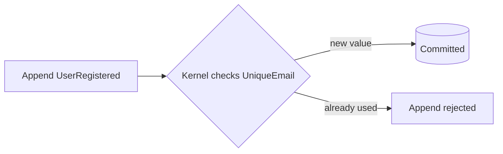

Cratis Chronicle constraints check declared rules in the server kernel before an event is appended. Use a uniqueness constraint when two event sources must not claim the same value, such as a registration email. The check belongs with the append, not in a read model that may be behind the event log.

This page explains how to choose and declare that rule, handle a rejection, and distinguish uniqueness from a decision that depends on current state. The [Constraints reference](/chronicle/constraints/) covers the options and operational limits.

## Why the check belongs in the kernel

In a CRUD application, a database `UNIQUE` constraint can reject a duplicate during the write. A materialized projection cannot do that job: it processes events after they are stored. Checking the projection before appending also leaves a race, because two requests can both see the email as available.

A Chronicle constraint moves the check into the append path:

When the kernel finds a conflicting claim, it rejects the append without storing the event. The registered rule applies to writers in its configured scope regardless of which client sent the append. Your application declares the rule and handles the result; it does not run a separate uniqueness query.

A constraint is checked within one namespace and event sequence, not across them. The event is made durable before the constraint index is updated, so those writes are not crash-atomic. Account for index recovery when operating the store; a pre-append check is not a promise that the event and its index share one storage transaction.

## Declare it on the event

In .NET, a property-level `[Unique]` attribute declares the rule beside the value it protects. Declaration support differs by client; the model-bound reference below identifies the available forms.

<ChronicleClientTabs snippet="understanding-constraints/property-attribute" />

The .NET client's convention-based discovery collects the attributes and registers the constraint with the kernel at startup. Give the same `name` to `[Unique]` on `UserRegistered.Email` and `UserEmailChanged.NewEmail` to check registrations and email changes against the same claims. By default, a property constraint retains one value per event source: claiming a new value releases that source's previous value. Choose a retention mode deliberately if earlier values must stay claimed.

Put `[Unique]` on the event type instead when the rule is one occurrence per event source, such as preventing a second `UserRegistered`:

<ChronicleClientTabs snippet="understanding-constraints/event-type-attribute" />

To release a claim when its owner is removed, declare the removal event with `[RemoveConstraint]`. If several events can end that lifecycle, mark each applicable event so each path releases the claim:

<ChronicleClientTabs snippet="understanding-constraints/remove-constraint" />

The [model-bound constraints reference](/chronicle/constraints/model-bound/) covers names, retention modes, removal, and client declaration support.

## When the rule outgrows an attribute

Use a dedicated definition when the rule is easier to read in one place, particularly when several event types contribute values or the violation message needs a callback. In .NET, implement `IConstraint` and describe the rule with its builder:

<ChronicleClientTabs snippet="understanding-constraints/dedicated-class" />

The .NET example brings two differently named properties under one constraint, ignores casing, and releases the claim when the user is removed. Its message callback lets the application supply a useful response. The event-type variant has a builder form too: `builder.Unique<UserRegistered>()` declares one `UserRegistered` per event source.

The .NET client's convention-based discovery also finds `IConstraint` implementations. Both forms produce kernel-side definitions; moving the declaration into a class does not move enforcement into the application. Consult the [declarative constraints reference](/chronicle/constraints/declarative/) for builder options and the capabilities of your chosen client.

## Constraints that close streams

A closing constraint lets a fact such as `BooksClosed` end a selected stream scope. The kernel commits the event and records the closure without allowing another append between those steps. Once closed, appends inside that scope are rejected with a `StreamClosed` violation.

The two writes are not crash-atomic: a stop after the event is stored but before the closure is recorded requires index recovery or reindexing. Choose the scope and recovery procedure using [Closing events](/chronicle/closing-streams/closing-events/). The [model-bound](/chronicle/constraints/model-bound/closing-stream/) and [declarative](/chronicle/constraints/declarative/closing-stream/) references show the declaration forms.

## What a violation looks like

A constraint violation is a failed append whose result identifies the constraint and provides violation details. Handle that result as an expected command outcome, for example by telling the user that the email is taken. Do not treat every failed append as a duplicate; inspect the reported failure. [Enforce a unique value](/chronicle/scenarios/enforce-a-unique-value/) walks through declaration and failure handling.

## Privacy and PII protection

A uniqueness rule may cover personally identifiable information (PII), such as an email address. Property uniqueness checks use a SHA-256 hash rather than storing that raw value in the index. The kernel joins the participating values with hyphens, lowercases the result when `IgnoreCasing()` is enabled, and hashes it. Equal normalized values therefore produce equal index keys.

You still declare the rule on ordinary properties. Hashing is not encryption or proof that an index is anonymous: predictable values can be guessed and hashed for comparison. Configure event-data protection separately for sensitive properties.

Chronicle's generated uniqueness message names the constraint and property, not the conflicting value. Keep custom messages equally careful; hashing an index does not prevent application code from exposing a value in a response.

## Constraints and concurrency

Choose the guard from the rule you need to hold. Uniqueness is about claims to a value; concurrency is about whether the state used for a decision has changed:

| Mechanism | Protects | Example |
|---|---|---|
| Constraint | A value claim within the configured scope of one namespace and event sequence | Two users must not claim the same email |
| Concurrency scope | An append carrying an expected position, checked against intervening events in the scope | Reject a save based on an outdated version |
| Decision read | An append guarded by the position captured when deriving state for one key | At most three loans per member |

A uniqueness constraint cannot count a member's loans. For that rule, a decision read derives state from the relevant events and supplies a guard for the append that follows. It does not make an email unique across different member keys. [Concurrency scopes](/chronicle/events/concurrency/) and [decision reads](/chronicle/read-models/decision-reads/) explain how to carry those guards; an ordinary fresh read does not add one automatically. Use [Choosing how a rule holds](/chronicle/dynamic-consistency-boundary/choosing/) to compare the options for your command.

## The pattern to take with you

Declare uniqueness where the relationship between events is clear, let the kernel check it during append, and make rejection part of your command's normal response. Then plan for the index's scope and recovery rather than treating it as a cross-store transaction.

If your next adoption question is how those event types can change after they are stored, continue to [Understanding event evolution](./understanding-event-evolution.md). That page explains how the kernel keeps multiple representations of an event for readers on different schema generations.
