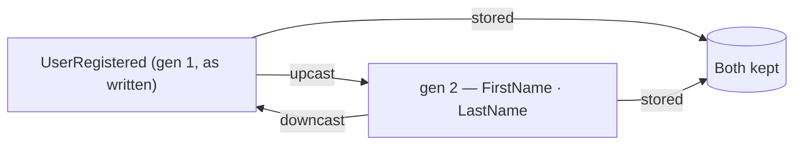

Cratis Chronicle event generations let readers use different versions of an event schema without replacing the stored representation. When `Name` becomes `FirstName` and `LastName`, you define how the kernel translates between the two shapes. New code can read the new generation while older code continues to read the one it understands.

Use generations for a schema change to the same business fact. The migration defines the translation; it cannot infer information the original event did not record. For example, splitting a person's name requires a deliberate rule for names that do not fit a first-name/last-name pattern.

## Translate, never edit

Each schema version of an event type is a generation. You define translations between adjacent generations in both directions: an upcast turns an older shape into a newer one, and a downcast turns the newer shape back into the older one. These mappings determine what each reader receives; do not assume that an automatically reversible transformation exists for every change.

With a registered 1→2 migration, appending a generation-1 event stores both generation 1 and the upcasted generation 2. Appending generation 2 also produces generation 1 through the downcast. The kernel stores the configured generations, so a consumer does not need to perform the translation on each read.

That lets two application versions use the same stored event: a newer service reads generation 2 while an older service reads generation 1. Their deployments need not happen together for this schema change, provided the mappings supply the data each version expects. Kernel upgrades have a separate rollout requirement, described below.

For events already stored, registering a new generation starts a background backfill job for that event type in the default namespace's event log only. It does not backfill other namespaces or event sequences. The job adds missing representations and leaves existing ones unchanged. Changing a migration definition alone neither replaces those representations nor starts another backfill.

The backfill uses revised content when a separate revision is present. Otherwise, it uses the known appended generation's base content. If the appended generation is unknown or its content is missing, it falls back to the highest stored base generation; an unknown appended generation remains unknown. Each addition records its source and migration-definition version alongside its content and hash. A concurrent revision, redaction, or competing backfill can prevent the write: the job re-reads and retries once, then logs and skips the event if the conflict persists.

Add-only backfill preserves what is currently stored, not content already lost. Earlier backfills may have overwritten generations, and SQL revisions replace generation content in place; upgrading cannot recover those originals.

Register new generations only after every kernel silo has been upgraded. A silo is an Orleans server instance. During a rolling upgrade, workers on the older release can still run replace-all backfills and overwrite content.

## Why the kernel owns this

The kernel applies registered migration definitions during append, independently of the client that sent the event. Application code declares the mapping, but the server performs the translation and stores the resulting generations. An older client does not need new migration code merely to keep reading its registered generation.

Server-side enforcement also matters when different writers must obey the same uniqueness rule. [Understanding constraints](./understanding-constraints) explains that related decision: which rules belong in the append path rather than in an application's read-before-write check.

## Where to go next

Use [Migrations](/chronicle/migrations/) to check declaration, registration, and validation details for your client. Then follow [Evolve an event](/chronicle/scenarios/evolve-an-event/) to define a generation change. Before deploying it, decide how both mappings handle missing information and confirm that the backfill scope covers the history your readers need.
