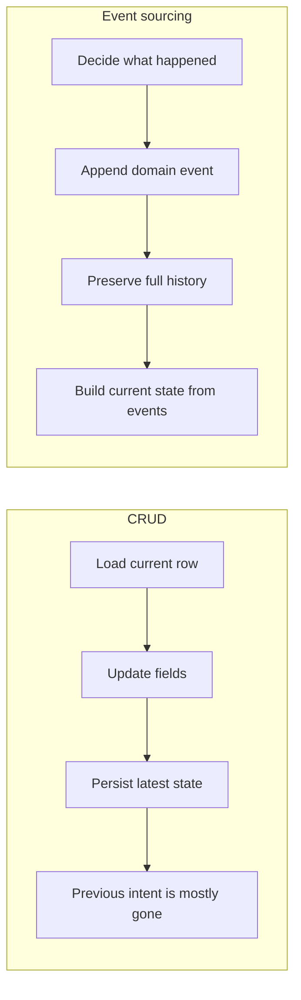
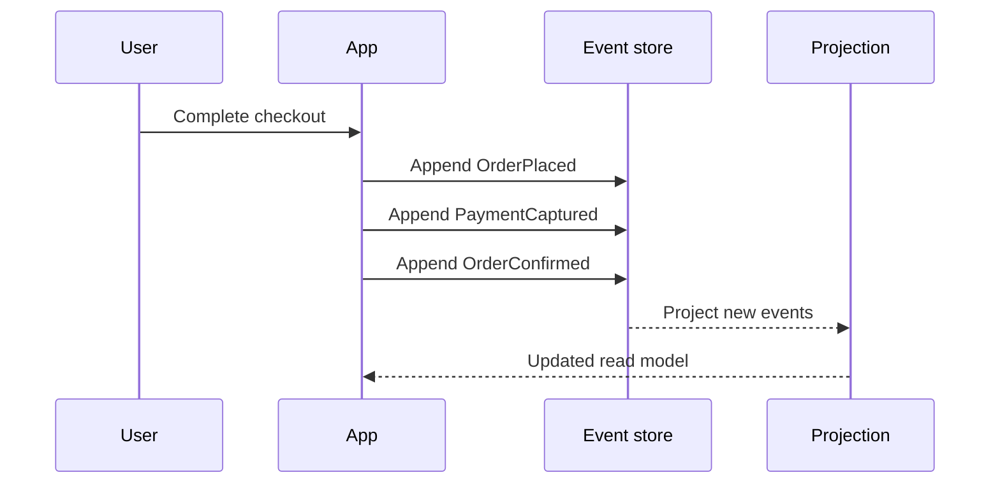

Event sourcing records meaningful changes as events rather than keeping only the latest state. Cratis Chronicle stores those events and derives queryable read models through projections. This preserves the changes your application records, so you can inspect how state evolved instead of trying to reconstruct it from the current row.

Consider an order marked as shipped. The current row tells you its status, but not necessarily which changes led there or what happened before payment completed. If those questions matter, the history belongs in the model rather than in a separate collection of diagnostic logs.

That is why Cratis recommends event sourcing as the starting point for information systems. Chronicle groups [events](./concepts/event.md) by [event source](./concepts/event-source.md), such as an order, in an [event store](./concepts/event-store.md). Its [projections](./concepts/projection.md) derive the views your application queries. The sections below explain the trade-off and how to choose the boundary around a business decision.

## CRUD focuses on state, event sourcing focuses on change

CRUD means create, read, update, and delete. You store a record, read it, and update or delete it as the application changes. That works well when current state is all you need. Unless you also keep history, an update replaces the previous values and loses the path that led to the current state.

Event sourcing starts from a different question: what meaningful state changes happened?

- `CustomerRegistered`
- `AddressChangedForCustomer`
- `PaymentCaptured`
- `OrderShipped`

Each name says what changed in business terms. `PaymentCaptured` records a different fact from `OrderShipped`, even if both would otherwise appear as updates to an order row. What you can later explain depends on which facts you chose to record and the information they carry.

## Events make behavior transparent

With CRUD, an `UPDATE Customers SET Address = ...` statement tells you very little about the business meaning. Did the customer move? Did support correct a typo? Was this part of a larger onboarding step?

You can make that distinction explicit with separate events for a move and a correction. A developer investigating a bug or an operator answering a support question can then follow the recorded changes instead of guessing from the latest address. The event names and payloads carry the explanation; event sourcing does not infer an intent you never recorded.

## Events help you think in processes

An order moves through approval, payment, and shipment. Modeling those changes as events gives each step a name and makes its relationship to the next step visible. You can discuss when to capture payment or confirm an order without starting from which columns to update.

In Chronicle, a [reactor](./reactors/index.mdx) can respond to one of these events by calling an external system or sending a notification. A [constraint](./concepts/constraints.md) serves a different purpose: it enforces an integrity rule when events are appended. Keep that distinction when adding approval logic or compensating actions; reacting after an append is not the same as preventing it.

## CRUD loses information unless you bolt it back on

A CRUD model usually keeps only the current representation of an entity. If a value changes ten times, the eleventh version overwrites the tenth. The intermediate states are gone unless you separately introduce:

- audit tables
- change data capture
- soft deletes
- history tables
- operational logs

Those are valid ways to retain history, but they are extra features to design and maintain alongside the current-state model. With event sourcing, the events are the source of truth. You can inspect their sequence when debugging and build another read model from the same recorded facts. Historical questions remain limited by the information those events contain.

Retaining history does not remove your responsibility to handle personal data. Chronicle's [compliance mechanisms](./compliance/index.md) include encryption for fields marked as personally identifiable information (PII) and erasure of the key tied to the person the data concerns. Plan that protection before writing personal data, and review [regulatory responsibilities](./compliance/regulatory-responsibilities.md) for obligations beyond the event store.

## Full event history creates opportunities beyond auditing

An event stream can provide historical inputs for analytics or model-training workflows, rather than only a current-state snapshot:

- the order of recorded changes
- timestamps for those changes
- actions recorded before an outcome
- business transitions represented by the event types

In a CRUD-only system, you may need to reconstruct that history from separate logs or snapshots. With event sourcing, the recorded changes are already in the event stream. Whether those inputs are useful for a model depends on the task and on what your application actually recorded; keeping history does not by itself establish better model results.

## Event sourcing is not just aggregate roots

Keeping events does not dictate how you make a business decision. You still need to decide which facts must stay consistent while concurrent writers act.

An **aggregate root** gives you a fixed consistency boundary around a model: you load its history, make a decision, and append new events from that boundary. If you use domain-driven design (DDD), this may be familiar. Cratis Arc provides [aggregate-root support on top of Chronicle](/arc/backend/csharp/chronicle/aggregates/).

### Aggregate roots

#### Pros

- familiar if you use classic DDD patterns
- clear ownership and invariants inside a fixed boundary
- straightforward mental model for single-entity decisions

#### Cons

- boundaries are fixed up front
- unrelated decisions can end up coupled into the same consistency scope
- cross-stream or cross-process decisions can become awkward

### Dynamic Consistency Boundary

[Dynamic Consistency Boundary](./dynamic-consistency-boundary/index.md) bases the consistency scope on the facts a decision actually needs at runtime rather than on a predeclared aggregate. Chronicle supports DCB-style decision models and append conditions within its event-source model, but it is not a DCB event store: each event has one event source ID, and custom tags do not participate in concurrency checks.

If you want Chronicle-specific guidance, read [Dynamic Consistency Boundary in Chronicle](./dynamic-consistency-boundary/chronicle.md).

#### Pros

- consistency follows the decision, not an arbitrary model shape
- easier to combine facts from multiple streams or read models
- less coupling and contention when decisions do not need a large fixed boundary

#### Cons

- less familiar if your team expects aggregate-centric design
- requires you to think carefully about the facts and constraints involved in each decision

:::note[Choose the consistency boundary]
The key point is that event sourcing does not require aggregate roots. Aggregate roots are one way to structure decisions. DCB-style decision models are another, within Chronicle's event-source and concurrency-scope limits. Choose the model that fits the problem instead of forcing every problem into the same shape.
:::

## Why we use it by default

We start with event sourcing when an application needs to explain business changes over time. That history can serve several distinct needs:

- transparency of business behavior
- auditability and compliance
- process-driven domains
- rebuilding views from history
- integration through events
- analytics or model training on full historical context

If a bounded part of your application only needs the latest state, CRUD can be the better fit. Event sourcing asks you to model meaningful facts, evolve their schemas, and account for when derived views catch up. Choose it where retaining and using history justifies that work.

## Evaluate the fit, then try it

Use [when to use event sourcing](./concepts/when-to-use-event-sourcing.md) to weigh those benefits against the modeling, schema evolution, and consistency work. If the trade-off fits your application, [get started with Chronicle](./get-started/index.mdx) to run a local kernel and choose a client setup guide.
